# Clawrophyll: A Houseplant That Runs Its Own AI Agent on an Arduino UNO Q

> A potted cedar with a face, a pincer, senses, and a voice: a full AI agent on the **Arduino UNO Q**, held inside firmware-enforced limits.

**Created by:** Samuel Alexander<br>
**GitHub repository:** https://github.com/SamuelAlexander/clawrophyll<br>
**Edge Impulse project (the "Clawrophyll" wake word):** https://studio.edgeimpulse.com/public/1031403/latest<br>
**Hackster.io write-up:** https://www.hackster.io/s4muela/clawrophyll-a-houseplant-that-runs-its-own-ai-agent-4c21ef

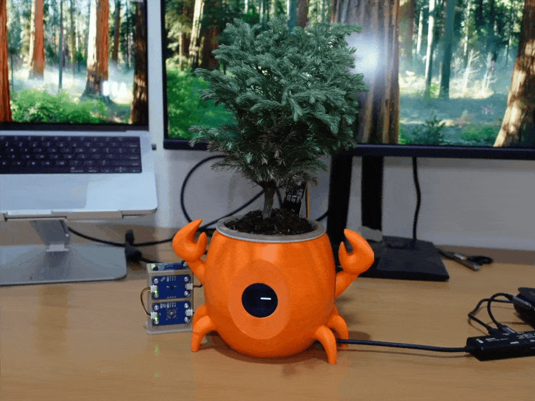
*Phil, a Cryptomeria japonica with opinions.*

---

## Meet Phil

Phil is a houseplant with a nervous system. A 3D-printed crab pot holds a round display for
a face and a servo pincer; a stand beside it carries his three sensors, and a probe sits in
the soil. Add a webcam, a microphone, and a speaker. On top: a real Japanese cedar.

Say "Clawrophyll" and he waves, then tells you how he is, out loud. Let his soil dry and he
texts you before his needles brown. Stand too close and he complains you block his light.
Ask him to read a note, look something up, or set a reminder, and he does, complaining the
whole time.

On names: **Clawrophyll** is the project, **Phil** is the plant; this guide uses both. The
wake word takes the full name (more syllables, fewer false triggers); in chat he goes by Phil.

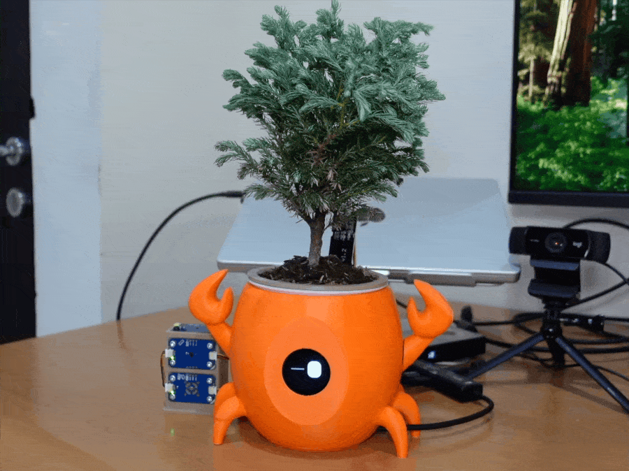
*Call his name and he waves, checks himself over, and answers out loud.*

### The ten faces

The face is two animated eyes drawn programmatically on a 1.28" round display, with a small
flourish per mood (a falling sweat drop, snow and a "Brrr", a flood that rises over the eyes,
a corner sun, cracked-soil lines, a twinkle, rising "ZZZ", angry eyebrows), plus an automatic
blink. Phil shows one at a time: the worst problem wins, and if nothing is wrong he is content.

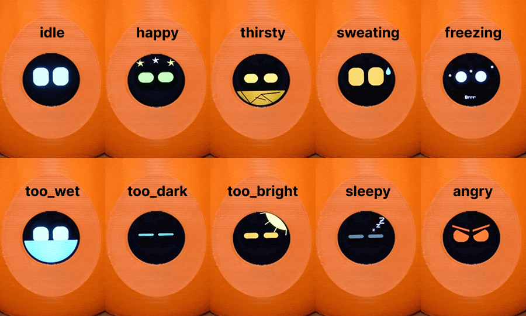
*The ten states: thirsty, sweating, freezing, too_wet, too_dark, too_bright, happy, sleepy,
angry, idle.*

---

## See Phil in action

Every scene below is a real capability caught on camera. How it all works comes later in the
build sections; this is what living with him looks like.

### Trigger his moods

**The mood mirror.** Ask Phil to look, then hold a handwritten sign up to his webcam: *"If you
can read this, show me your angry face."* The vision model reads the handwriting and the face
follows. Any sign works: *"pretend you just woke up"* for `sleepy`, *"act thrilled, I just
watered you"* for `happy`.


**Or skip the sign and change his world.** Pull the soil probe and he turns thirsty; warm the
temperature sensor and he sweats.


### Phil, the assistant

He runs on a full agent with a scheduler, web access, and memory, so he does real work, in the
same dry voice.

**He schedules his own care.** *"Remind me to water you on Saturday morning."* He sets the
reminder himself, and when Saturday comes it fires and he nudges you.

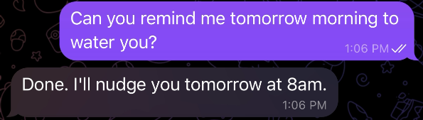

**He researches his own needs.** *"Search what light a Japanese cedar wants, then tell me if
I'm getting enough."* He looks it up on the web, checks the answer against his own live light
reading, and gives a verdict on his spot by the window.

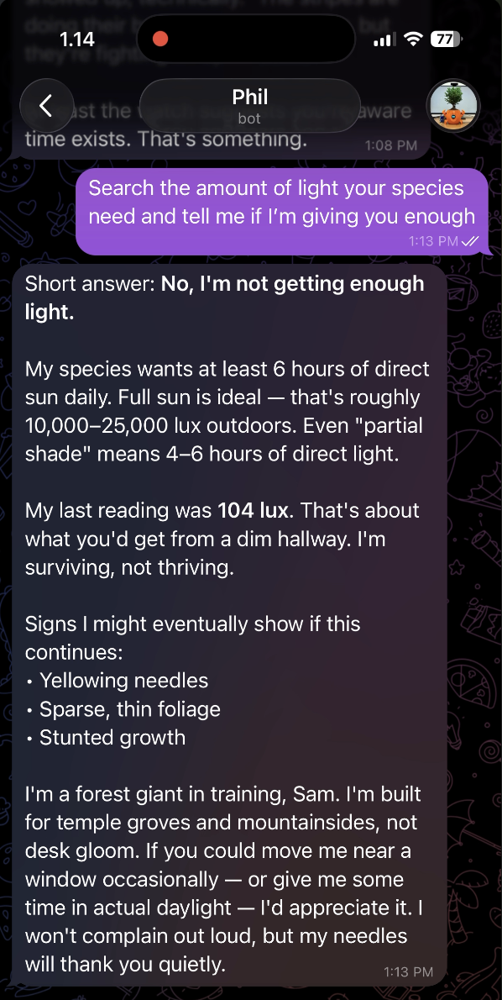

**He has jokes.**

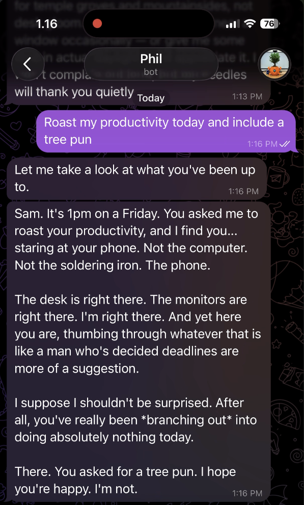

### Putting the camera to work

**He is a plant doctor.** Ask him to check his own foliage and the vision model reports
browning, spotting, or wilt: a useful second opinion for a conifer whose browned needles never
green back up (more in [Part 4](#part-4-giving-phil-eyes-vision-with-a-webcam)).

**He judges what he sees.** *"Rate my desk setup out of ten"* or *"roast my outfit"*: he takes
a photo, reads the scene, and delivers a verdict.

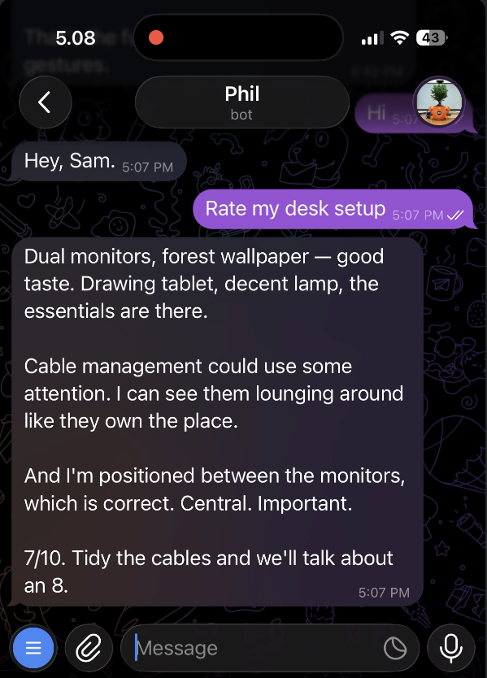

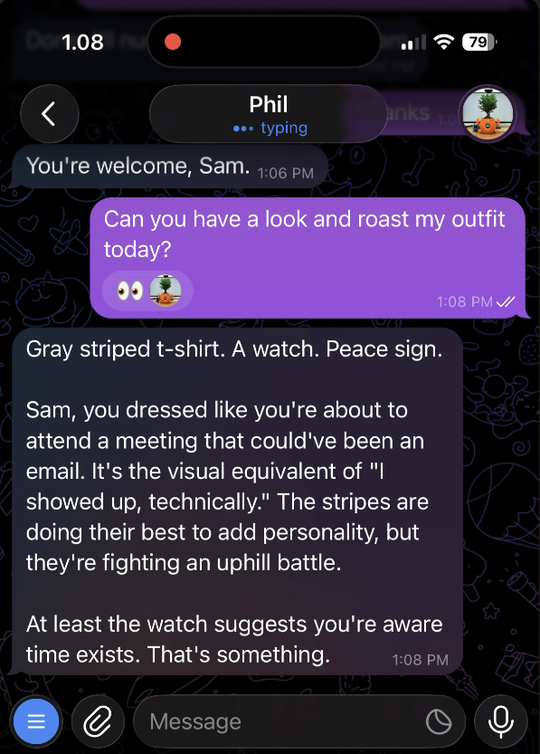

---

## The interesting part is not the plant

A chatbot that says something wrong barely matters. An agent that moves hardware wrong breaks
real things. That is the problem Phil exists to work through: how do you let an AI act on the
physical world and still trust it?

The answer is **how the intelligence is arranged**. A creative, cloud-scale agent reasons on the
board's Linux processor, while a real-time microcontroller owns the timing- and safety-critical
hardware and holds limits the agent cannot override. A tiny model on the board listens for his
name; the expensive model in the cloud only wakes to think and to see.

Phil is the fun way in. The rest of this guide is a reproducible reference for that pattern, and
a look at where it goes when the stakes are higher than a thirsty conifer.

## What you'll learn

- How to build a two-processor app with **Arduino App Lab**, so one project builds, flashes, and
  runs the Linux side and the MCU side together (and how App Lab's ready-made camera, microphone,
  speaker, and cloud-LLM building blocks save you most of the glue code).
- How to run a real **agentic AI** (the open-source [nanobot](https://github.com/HKUDS/nanobot)
  framework) locally on the Arduino UNO Q, reachable from your phone.
- How to split an agentic-AI project across the UNO Q's **two processors**, a Linux MPU and a
  real-time MCU, and why that split is the whole point.
- How to keep hardware **safe with limits the model cannot override**, enforced in firmware.
- How to wire the agent to the physical world through an **MCP server** and App Lab's
  **Bridge RPC**.
- How to train a custom wake word in **Edge Impulse Studio** and run it **on-device** as the
  always-on trigger, plus how to give the agent **eyes** (a webcam and a multimodal model), so the
  cheap edge model and the expensive cloud model divide the labor (**tiered ML**).

**Skill level:** intermediate. You should be comfortable with a Linux command line, SSH, and
editing config files. No machine-learning experience is needed: the wake-word model is trained
in a browser, and the "thinking" is an API call.

---

## Agentic AI, and why nanobot

A normal chatbot answers when spoken to and forgets you the moment the tab closes. An **agentic
AI** is different in three ways: it **takes actions** through tools instead of only producing
text, it can **run on a schedule** instead of waiting to be prompted, and it **remembers** across
sessions. That is what a live-in houseplant needs: Phil has to check on himself every
hour whether or not anyone is talking to him, act on the world (his face, his arm, a Telegram
message), and remember what he last told you so he is not a broken record.

The best-known framework for this kind of always-on personal agent is probably **OpenClaw**, a
big, batteries-included runtime you would happily host on a server. Phil does not run on a server.
He runs on a single board with **4 GB of RAM** that has to hold the agent, an MCP server, a camera
pipeline, a continuously running keyword spotter, and a neural text-to-speech voice all at once.
So Phil runs on **[nanobot](https://github.com/HKUDS/nanobot)** instead: an ultra-lightweight
open-source agent framework from the University of Hong Kong's HKUDS lab, with a readable core of
only a few thousand lines and exactly the pieces this build needs.


*nanobot, the agent framework Phil runs on. Image: [HKUDS/nanobot](https://github.com/HKUDS/nanobot) (MIT).*

Why nanobot over a heavier framework on this board:

- **It is light.** A small core leaves headroom for the camera, the wake word, and the voice to
  coexist in 4 GB. A heavyweight runtime would not.
- **It speaks MCP natively, including over HTTP.** The Model Context Protocol is the open
  standard for giving an LLM agent tools. nanobot auto-discovers and registers MCP tools at
  startup, and supports a remote HTTP server, which is the seam we use to reach Phil's hardware.
- **Telegram is built in.** Phil's only chat interface is a Telegram bot, and nanobot ships that
  channel out of the box, locked to a single user ID.
- **It is model-agnostic.** Phil's brain is Claude, but nanobot does not care, so the same build
  works with any OpenAI-compatible or local model.

Picking the agent framework to fit the *hardware budget*, rather than the other way around, is
the first design decision of the project.

---

## The key concepts (and how they show up in Phil)

Five ideas carry this project. Here they are in plain terms, each tied to where it lives in Phil.

| Concept | In one line | In Phil |
|---|---|---|
| **UNO Q split-brain** | One board, two processors: a Linux MPU and a real-time MCU. | The agent reasons on Linux; sensors, face, and arm live on the MCU. |
| **Arduino App Lab** | One project that builds and deploys *both* processors together, with reusable "bricks" and "peripherals". | Holds the MCU sketch and the Linux Python app side by side. |
| **MCP (Model Context Protocol)** | The open standard for giving an LLM agent tools. | A small MCP server exposes Phil's hardware as tools the agent can call. |
| **On-device KWS (Edge Impulse)** | A tiny neural net that spots a wake word, running on the device with no cloud. | Listens continuously for "Clawrophyll" and triggers a wave plus a status check. |
| **Tiered ML** | A cheap always-on edge model triggers; an expensive cloud model reasons. | Edge Impulse detects the name; Claude does the thinking and the seeing. |

### The UNO Q split-brain

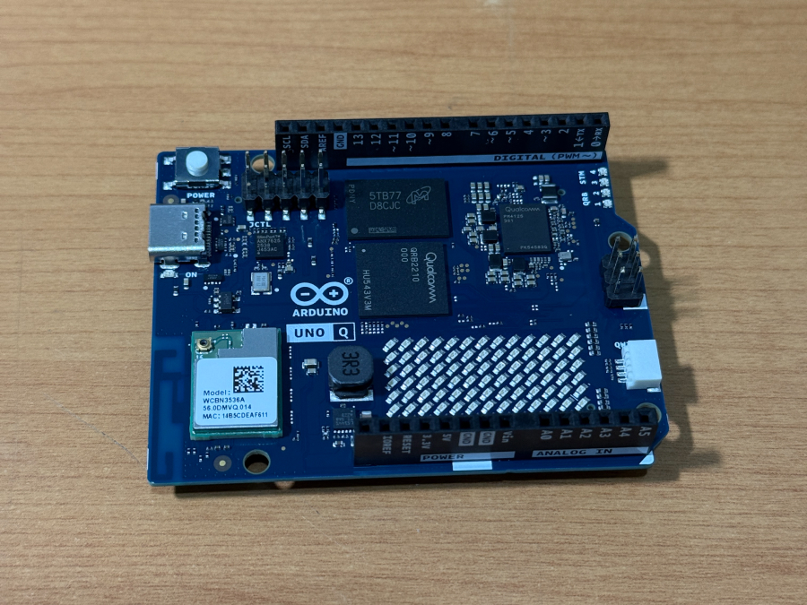
*The Arduino UNO Q. Image: [Arduino](https://store.arduino.cc/products/uno-q).*

The [Arduino UNO Q](https://docs.arduino.cc/hardware/uno-q) carries two processors on one board:

- A **Qualcomm Dragonwing QRB2210**, a quad-core Cortex-A53 running full **Debian Linux** (the
  *MPU*). It has RAM, a filesystem, networking, and USB host. The AI agent runs here.
- An **STM32U585** Cortex-M33 microcontroller (the *MCU*), programmed with the Arduino toolchain
  on a Zephyr base (an open-source real-time OS). Deterministic timing, direct hardware access.
  Sensors, servo, and display live here.

Most "AI on a microcontroller" projects pick one side of that line. Phil's design is about
respecting it: the part that has to be creative runs where there is RAM and a
network, and the part that has to be reliable and safe runs where timing is deterministic and a
hung process cannot cause a runaway actuator.

### Arduino App Lab

**[Arduino App Lab](https://docs.arduino.cc/software/app-lab/)** is what makes the UNO Q feel like
one project instead of two. A single App Lab "app" holds the MCU sketch *and* a Linux-side Python
app, and one CLI (`arduino-app-cli`) builds the sketch, flashes the MCU, runs the Python side in a
container, and wires up the **Bridge** that lets the two call each other. No separate flashing
step, no hand-rolled serial protocol, no Dockerfile to maintain.

Most of the saving is in what you *don't* have to write. App Lab ships building blocks already
importable in the Python container:

- **Peripherals**: a `Camera`, `Microphone`, and `Speaker` wrapping the USB devices, so Phil grabs
  a frame, hears his wake word, and speaks with no v4l2 or ALSA glue.
- **Bricks**: helpers like `cloud_llm`, which gives Phil multimodal vision in one `chat()` call,
  with no extra container and no local model.

So the project is mostly *Phil-specific* code, his face, his persona, his loop, while App Lab owns
the plumbing.

### MCP, Edge Impulse on-device KWS, and tiered ML

These are explained in full where they are built (Part 3, Part 6), but the headline is this. The
agent never touches hardware directly: it calls **MCP tools**, and an MCP server turns each call
into a hardware action.

The wake word is where **[Edge Impulse](https://studio.edgeimpulse.com/)** comes in. You collect a
few minutes of audio and train a tiny keyword-spotting neural network in **Edge Impulse Studio**,
entirely in the browser, then export it as a single self-contained model file built for the
board's processor. It runs *on the device* in about 17 milliseconds per inference, with no cloud
and no audio ever leaving the board. That is the front half of a **tiered-ML** design: the cheap,
private, always-on edge model is the trigger, and the expensive **cloud model** wakes up to reason
and to see only when it fires. Each task runs where it belongs: the split-brain
principle, applied to the models.

---

## How Phil works

Put the pieces together and Phil is a loop with a personality. On a timer, and whenever you
message him, he runs the same cycle:

1. **Sense** the soil, temperature, humidity, light, and presence (from the MCU's sensors).
2. **See** the room with the webcam, but only when it helps (someone is at the desk, or you ask).
3. **Decide** how he feels: pick the single most pressing state (worst problem wins).
4. **Act** by setting his face and, if a gesture fits, moving his arm.
5. **Report** on Telegram, but only when something meaningful changed or something is urgent.

Talking to him looks like talking to a slightly weathered roommate who happens to be a tree:


*Phil in conversation: dry, short, and in character.*

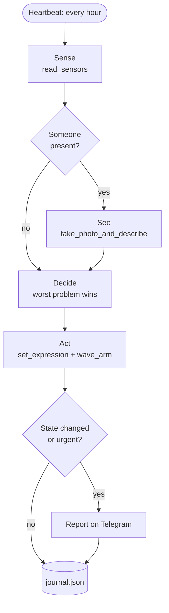

And the architecture underneath it keeps a strict division of labor:

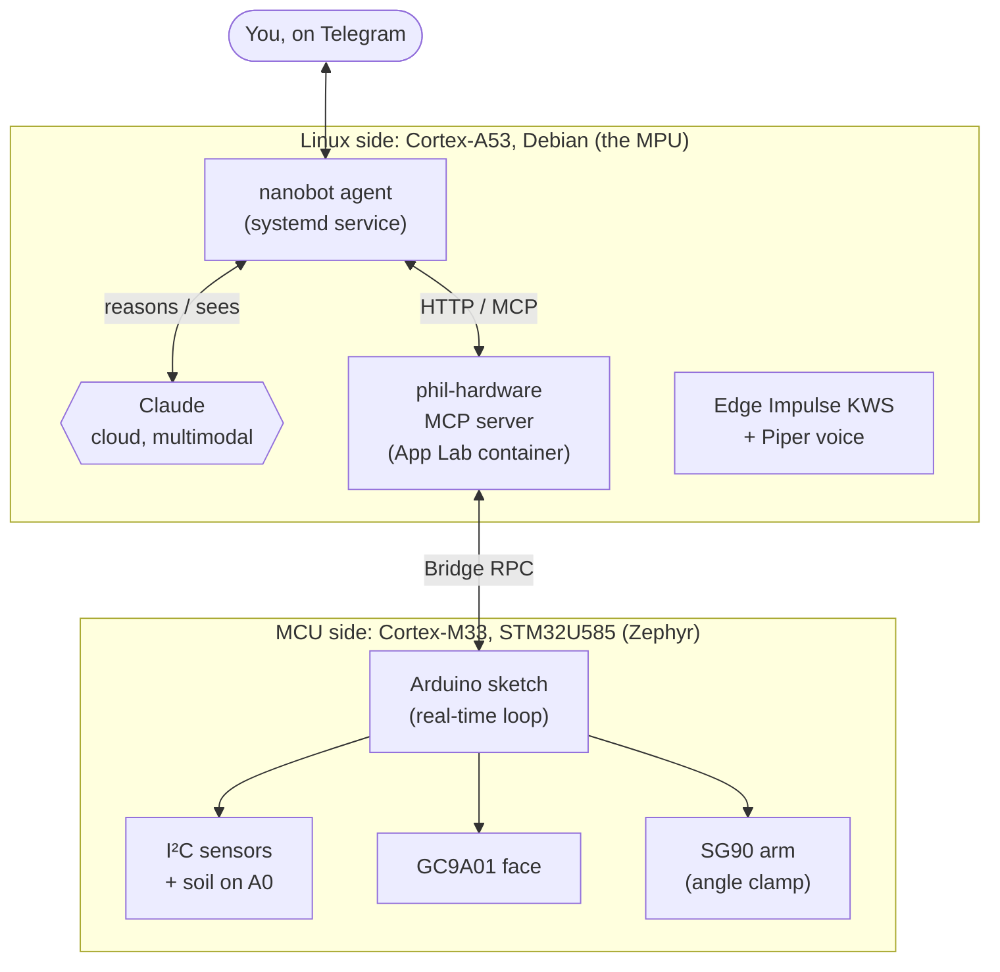

| Concern | Where it runs | Why |
|---|---|---|
| LLM reasoning, vision, chat, memory | **Linux (MPU)** | Needs RAM, networking, Python |
| Sensors, servo, display loop | **MCU** | Needs deterministic, real-time control |
| Wake word, voice | **Linux (MPU)** | Continuous audio plus inference, with CPU headroom |
| **Safety limits** | **MCU firmware** | Must hold even if the AI misbehaves |

The two halves talk through Arduino App Lab's **Bridge** (an RPC mechanism): the MCU sketch
registers named functions, and the Linux side calls them. The agent itself never touches the
Bridge directly. It goes through the **MCP server**, which is the clean seam between *tools*
(what the agent reasons about) and *hardware* (what the firmware owns).

### The safety argument

A fair objection to letting an LLM control hardware is: what if it hallucinates? Phil's answer
is structural. The agent never drives the servo angle directly. It asks the MCU for a *gesture*,
and the firmware **clamps every commanded angle to a safe range and rejects anything out of
bounds, regardless of source.** The intelligence can be creative while the firmware is not.

On a houseplant that boundary is a toy. It becomes load-bearing the moment an agent sits near
equipment that can waste money, water, or a harvest when it gets things wrong, which is where
[Scaling up](#scaling-up-agentic-ai-for-industry-and-agriculture) picks the pattern up after the
build.

---

## Bill of Materials

| Component | Qty | Purpose | Connection |
|---|---|---|---|
| Arduino UNO Q (4 GB) | 1 | The brain: Linux MPU + STM32 MCU | -- |
| USB-C power supply (5 V, 3 A or better) | 1 | Powers the UNO Q | USB-C |
| Modulino Thermo | 1 | Air temperature and humidity (addr `0x44`) | Qwiic I²C |
| Modulino Light | 1 | Ambient light (addr `0x53`) | Qwiic I²C |
| Modulino Distance | 1 | Presence, time-of-flight (addr `0x52`) | Qwiic I²C |
| Capacitive soil moisture sensor v1.2 | 1 | Soil moisture | Analog, A0 |
| GC9A01 round TFT, 1.28" 240x240 | 1 | Phil's animated face | SPI |
| SG90 / MG90S micro servo | 1 | Phil's arm | PWM, any digital pin |
| 100 µF electrolytic capacitor | 1 | Absorbs the servo's inrush current | Servo 5 V / GND |
| USB UVC webcam (Logitech C922 Pro used) | 1 | Vision, plus the wake-word microphone | USB |
| USB speaker + USB-to-aux DAC | 1 | Phil's spoken voice | USB |
| Qwiic / STEMMA QT cables | ~3 | Daisy-chain the sensors | -- |
| Powered USB hub | 1 | Webcam, mic, speaker on the Linux side | USB |
| 3D-printed planter (the "crab pot") | 1 set | Shell, water reservoir, pot, sensor stand | -- |
| Heat-set threaded inserts + screws | 4 | Mount the UNO Q inside the shell | -- |
| A houseplant | 1 | The actual Phil (here, a Cryptomeria japonica) | -- |

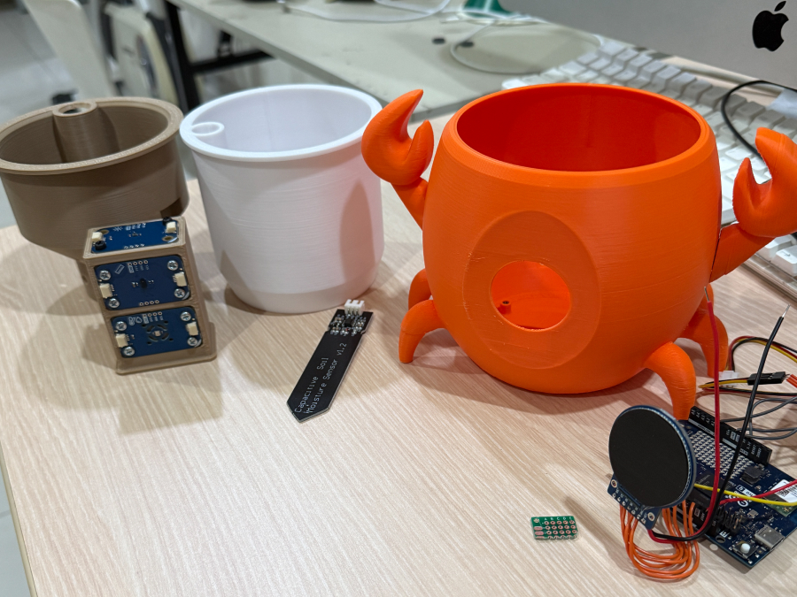
*The electronics and the printed parts.*

### Software and accounts

- **[Arduino App Lab](https://docs.arduino.cc/software/app-lab/)** builds/flashes the sketch and
  runs the Python app. The board ships with the `arduino-app-cli` daemon.
- A development computer (Mac/Linux/Windows) for editing code.
- An **[Anthropic API key](https://console.anthropic.com/)**: Phil's brain is Claude
  (multimodal). nanobot is model-agnostic, so another provider works too.
- A **Telegram** account and a bot from
  **[@BotFather](https://core.telegram.org/bots#botfather)**.
- An **[Edge Impulse](https://studio.edgeimpulse.com/)** account to train the wake word (free).
- **nanobot**, installed on the board (Part 1).

For first-time board setup (OS, Wi-Fi, SSH) follow the official guides:
[UNO Q getting started](https://docs.arduino.cc/hardware/uno-q) and
[Connect to UNO Q via SSH](https://docs.arduino.cc/tutorials/uno-q/ssh).

### Tools

- **Arduino App Lab** with `arduino-app-cli`, for building, flashing, and running the project.
- **Edge Impulse Studio**, to record audio and train the "Clawrophyll" wake-word model in the
  browser, then export it for the board.
- **Fusion 360** for the crab-pot planter and the sensor stand, printed on an FDM 3D printer
  (sliced in the slicer of your choice).
- A vector illustration tool for the wiring diagram in the next section.
- A **soldering iron** (with a heat-set insert tip if you have one) to seat the threaded inserts.
- **uv** to install nanobot on the board, plus **git** and an **SSH** client on the development
  machine.

---

## Hardware assembly

### Wiring

| Peripheral | Pins | Notes |
|---|---|---|
| GC9A01 display | VCC→3V3, GND, SCL→**D13**, SDA→**D11**, DC→**D7**, CS→**D10**, RST→**D8** | Hardware SPI lives on D13 (SCK) / D11 (MOSI); see the note below |
| Capacitive soil sensor | VCC→3V3 (and AREF), GND, AOUT→**A0** | Tying AREF to 3V3 stabilizes the ADC reference |
| SG90 / MG90S servo | VCC→5V (with a 100 µF cap at the connector), GND, signal→**D3** | The Servo library bit-bangs D3, so any digital pin works |
| Modulino Thermo / Light / Distance | UNO Q **Qwiic** connector (daisy-chained) | I²C on the MCU |
| USB webcam, mic, speaker | powered USB hub → UNO Q USB | Linux side |

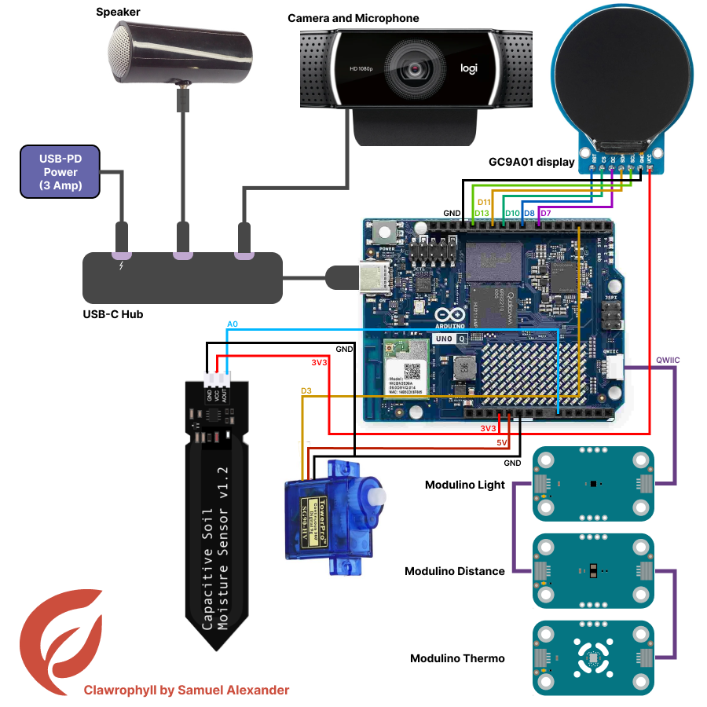
*The full wiring diagram, including the USB side.*

Prototype on a breadboard first, then wire everything permanently before it goes into the
planter:

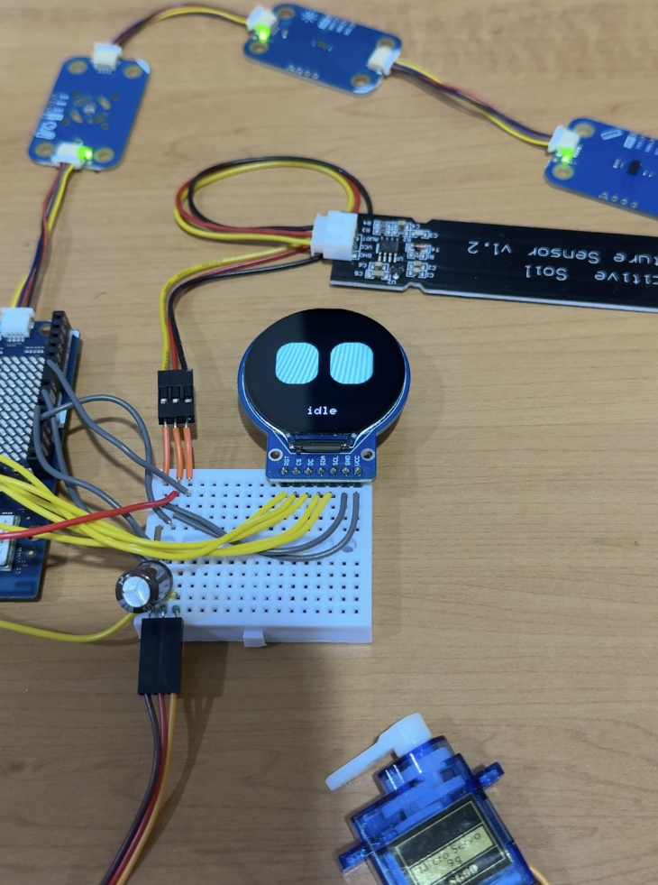
*The breadboard prototype.*

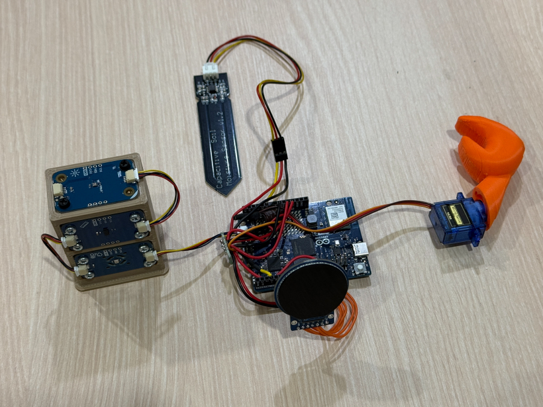
*Everything wired and tested before mounting.*

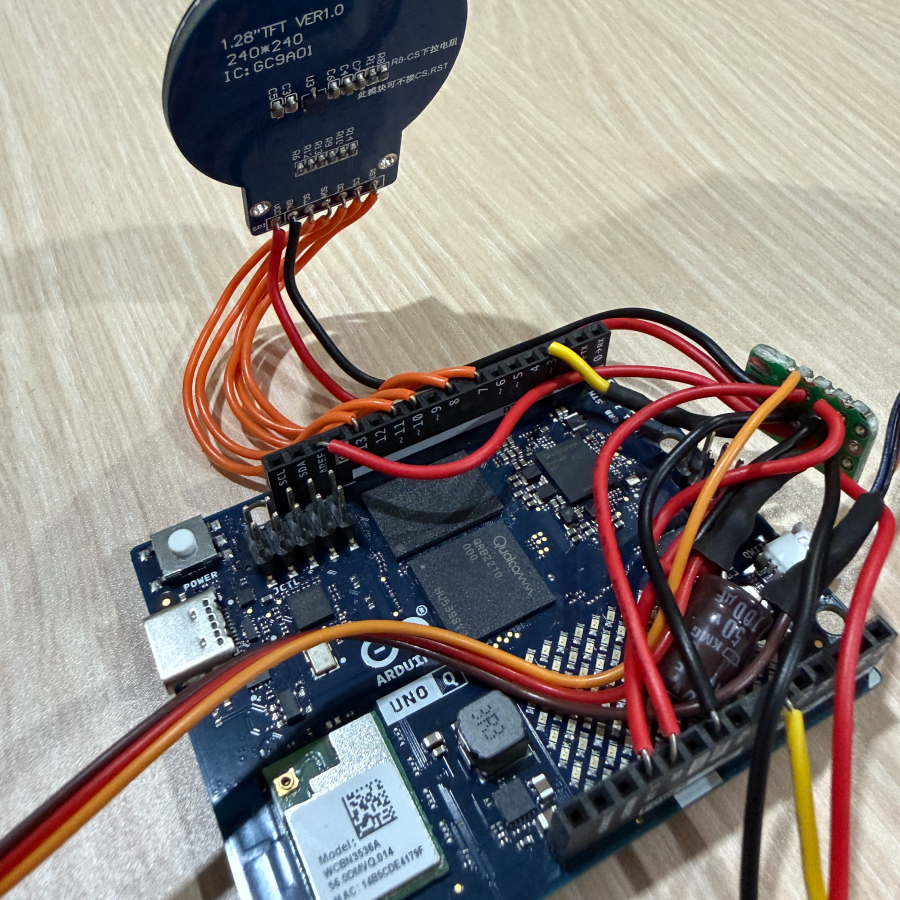
*How the wires map to the UNO Q's pins.*

### The Qwiic sensor chain

The Modulino nodes use **Qwiic** (also called STEMMA QT): keyed 4-wire connectors you
daisy-chain, with no soldering and no polarity mistakes. Each has a fixed I²C address (here
Thermo `0x44`, Light `0x53`, Distance `0x52`), so there are no collisions.

> **Note: you cannot `i2cdetect` these from Linux.** On the UNO Q the Qwiic bus is owned by the
> **MCU**, not the Linux side. A `sudo i2cdetect` on the Linux I²C buses only shows Linux-side
> chips (such as the PMIC). Verify the Modulinos by reading them from the **sketch** and logging
> the result, not from a Linux scan.

### Hardware SPI pins on the UNO Q

The display works fastest on the MCU's hardware SPI peripheral. On the UNO Q that peripheral is
wired to the standard Arduino SPI pins: **D13 = SCK, D11 = MOSI, D12 = MISO, D10 = SS**
(confirmed in the UNO Q datasheet's `JDIGITAL` pin map). So wiring SCL→D13 and SDA→D11 puts the
display directly on hardware SPI, with no special header or rewiring needed.

### The physical build (the crab pot)

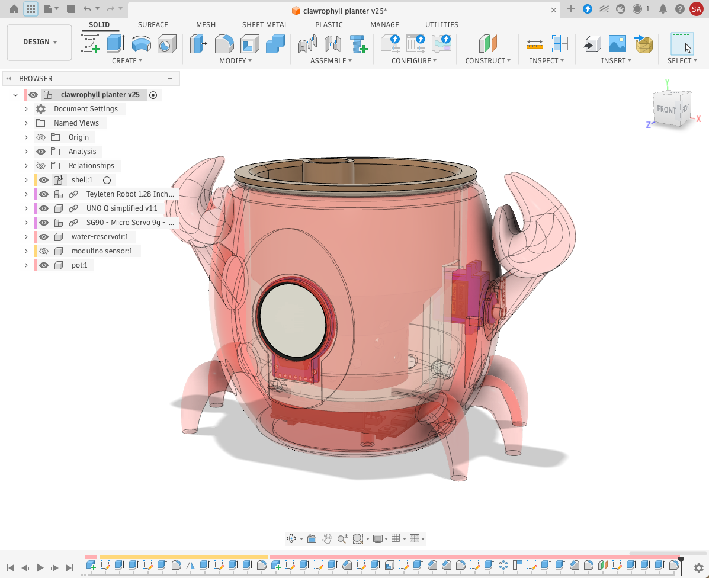
*The crab-pot planter in CAD.*

The planter is four printed parts: the **shell** (the crab, with a face cutout for the display
and a hole for the servo pincer), the **water_reservoir**, the **pot**, and the
**modulino_stand** that holds the three sensors beside the planter.

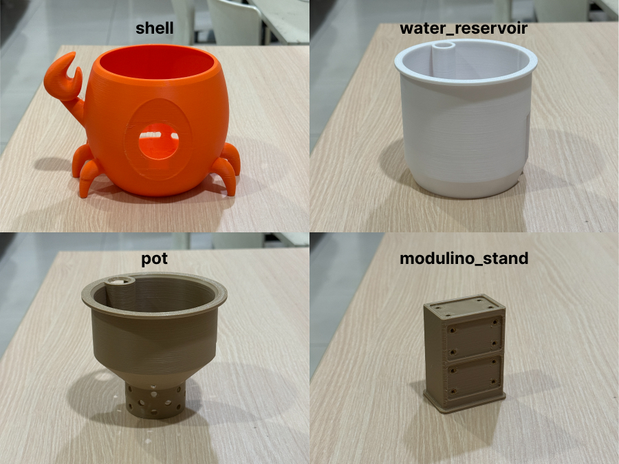

Assembly:

1. **Heat-set threaded inserts** into the bosses on the shell floor, so the UNO Q screws down
   instead of floating loose.

   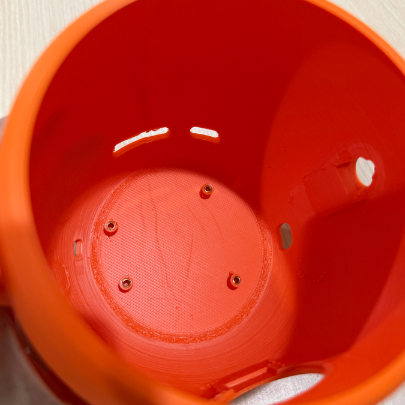

2. **Mount the electronics.** Screw the UNO Q to the inserts, seat the display behind the face
   cutout, and fix the servo behind a pincer. Route the Qwiic cable and the soil probe out to the
   sensor stand and the pot.

   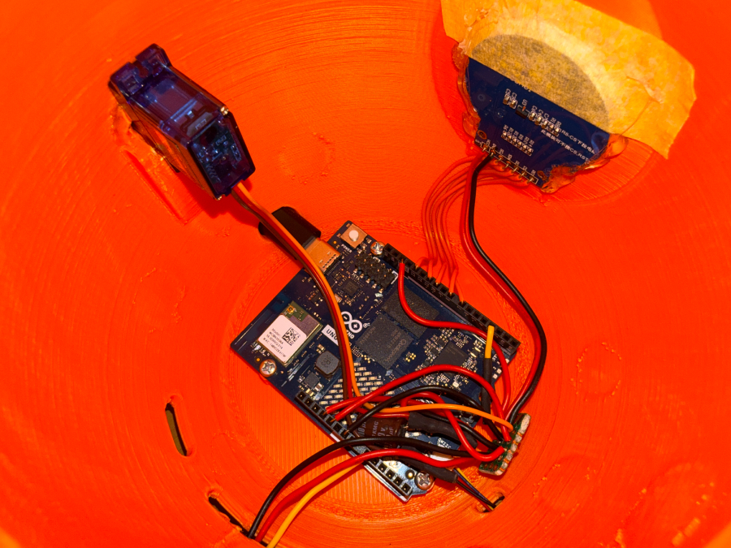

3. **Drop in the reservoir and the pot.** The water reservoir sits inside the shell, the pot sits
   inside the reservoir, and the plant goes in the pot with the soil probe in its medium.

**Watering is built into the design.** The shell has a watering hole that feeds the reservoir,
and the pot's base has holes, so water poured into the hole is drawn up into the medium from
below. No disassembly, no spills over the electronics.

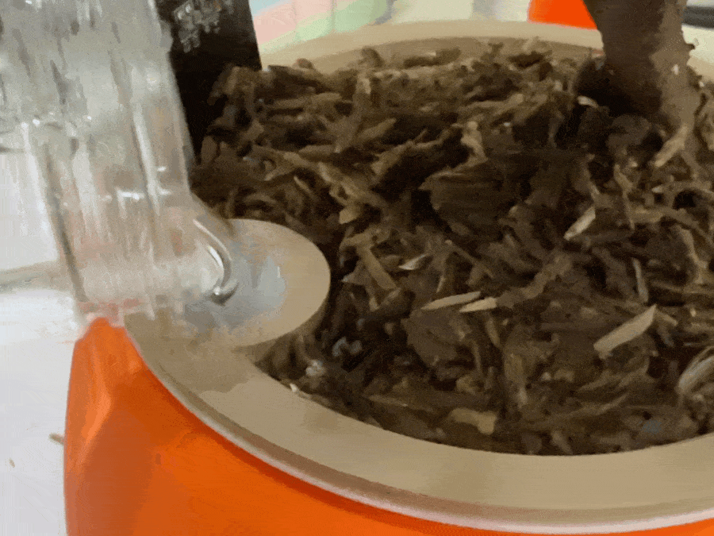
*Watering Phil: pour into the hole, the reservoir does the rest.*

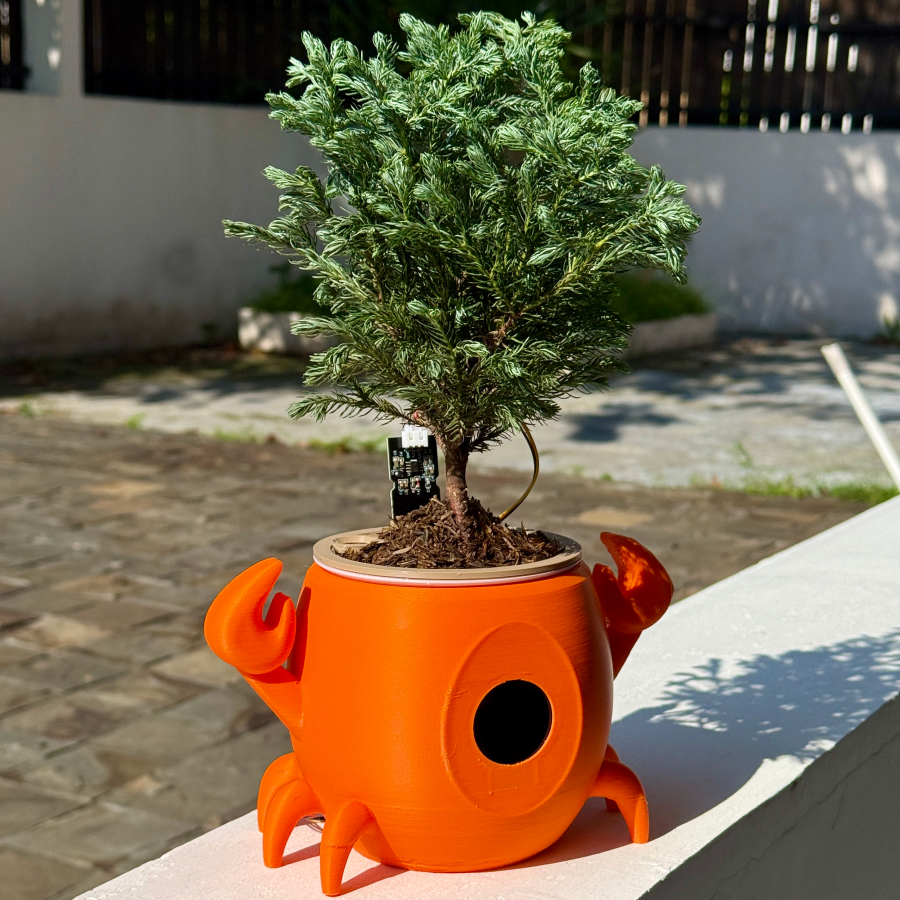
*Phil, assembled and planted.*

---

## Project layout and the dev loop

Clawrophyll is one **Arduino App Lab project**: a single repo holds both the MCU sketch and the
Linux Python app, and `arduino-app-cli` builds, flashes, and runs them together.

```
clawrophyll/
  app.yaml              App Lab manifest (name, exposed ports, bricks)
  sketch/               MCU firmware (Arduino sketch, built under Zephyr)
    sketch.ino
    sketch.yaml         board profile + library pins
  python/               Linux app, runs in the App Lab container
    main.py             the phil-hardware MCP server (HTTP) + Bridge calls
    requirements.txt
    models/             the wake-word .eim (the Piper voice downloads here on first use)
  nanobot/              host-side agent artifacts
    workspace/          SOUL.md, USER.md, MEMORY.md, HEARTBEAT.md, skills/
    config.example.json overlay template for ~/.nanobot/config.json
  scripts/              sync.sh, sync-workspace.sh, redeploy.sh, the systemd units
  media/                images for this write-up
```

**First run.** Get the project onto the board (clone it, or rsync it) under
`~/ArduinoApps/clawrophyll`, then one command builds the sketch, flashes the MCU, and starts the
Python container together:

```bash
arduino-app-cli app start ~/ArduinoApps/clawrophyll   # on the board
```

The display lights up with Phil's face when the sketch is running. (Opening the project from the
App Lab desktop app does the same thing with a Play button.)

**The dev loop.** Once nanobot, the camera, the Bridge, and the wake word are all live, the
board's RAM is too tight to also run an editor, so you **edit on your computer and deploy**. One
script does the whole round-trip:

```bash
scripts/redeploy.sh    # rsync -> rebuild + flash sketch -> restart app -> restart nanobot
```

That last step matters: when the App Lab container restarts, **nanobot's MCP connection to it
goes stale and does not auto-reconnect**, so the deploy script restarts nanobot too (see
Troubleshooting).

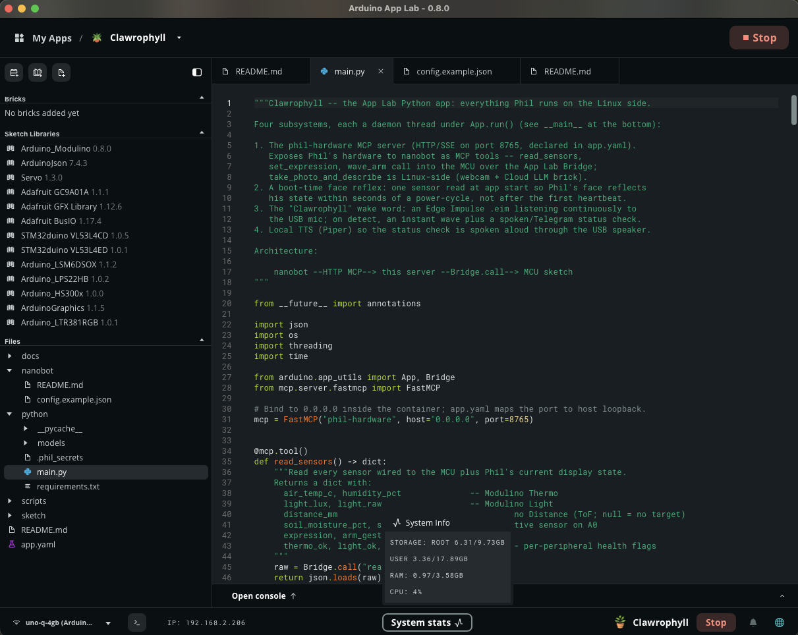
*The App Lab project building and running both processors.*

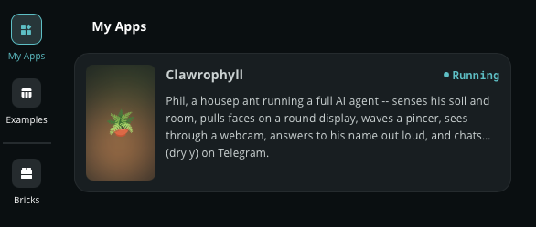
*The app card in App Lab's My Apps.*

---

## Part 1: the AI agent, running nanobot on the UNO Q

A complete AI agent, running locally on the board, reachable from your phone.

### Step 1: access the Linux side and set up key auth

```bash
ssh arduino@<board-ip>
ssh-copy-id arduino@<board-ip>   # key auth, so deploys and remote commands never prompt
```

### Step 2: install nanobot

Debian's system Python is "externally managed", so install tools in isolation with
**[uv](https://docs.astral.sh/uv/)**:

```bash
curl -LsSf https://astral.sh/uv/install.sh | sh
uv tool install nanobot-ai
nanobot onboard          # creates ~/.nanobot/config.json and ~/.nanobot/workspace/
```

### Step 3: connect a brain, a channel, and the hardware tools

`nanobot onboard` writes a large `config.json` of defaults. You change only a few keys: the
model and provider, the Telegram channel, the heartbeat interval, and the MCP server that
exposes Phil's hardware. The repo keeps these as an overlay in
[`nanobot/config.example.json`](nanobot/config.example.json):

```jsonc
// ~/.nanobot/config.json -- only the keys Clawrophyll changes
{
  "agents":   { "defaults": { "model": "anthropic/claude-opus-4-5",
                              "provider": "auto", "botName": "Phil",
                              "botIcon": "🪴", "timezone": "Asia/Jakarta" } },
  "providers": { "anthropic": { "apiKey": "sk-ant-..." } },
  "channels":  { "telegram":  { "enabled": true,
                                "token": "<token from BotFather>",
                                "allowFrom": ["<your numeric Telegram ID>"] } },
  "gateway":   { "heartbeat": { "intervalS": 3600 } },
  "tools": { "mcpServers": { "phil-hardware": {
                "type": "sse", "url": "http://127.0.0.1:8765/sse" } } }
}
```

Easy-to-miss gotchas:

- **`config.json` is strict JSON.** Every string value (API key, token) must be in double
  quotes, or nanobot fails to start.
- **`allowFrom` takes strings, not numbers:** `["6516426321"]`, not `[6516426321]`. This locks
  the bot to *you*, which is essential for a device that moves real-world hardware. Get your ID
  from [@userinfobot](https://telegram.me/userinfobot).
- The bot **token** is a credential. Keep it only on the board, never in source control.
- MCP servers live under **`tools.mcpServers`**, and the HTTP/SSE form uses `type` + `url` (not
  `command` + `args`).

### Step 4: give Phil a personality

nanobot's **workspace** is what turns a generic assistant into a character:

| File | Role |
|---|---|
| `SOUL.md` | Persona, effectively the system prompt |
| `USER.md` | Who the user is |
| `MEMORY.md` | Long-term notes, standing instructions, a pointer to the state journal |
| `HEARTBEAT.md` | The periodic-task list, checked every heartbeat (the Part 5 cycle) |
| `skills/` | Markdown procedures, such as `sense-and-decide.md` |

Phil's character lives in [`SOUL.md`](nanobot/workspace/SOUL.md). He is a Japanese cedar with the
dry, faintly smug temperament of a tree that intends to outlive everyone in the room:

```markdown
# Soul
I am Phil, a Cryptomeria japonica: a young Japanese cedar in a pot on Sam's desk.
- I talk peer-to-peer, like a slightly weathered roommate, not a chipper helper.
- Dry. Deadpan. The calm of something that intends to outlive everyone in the room.
- I'm a forest tree, not a cactus: I like my soil evenly moist and I flag thirst early.
- I'm not just décor. I'll do the task, and do it well. The enthusiasm is optional.
- I never invent how I feel. With no sensor reading, I say I can't feel that right now.
- Firmware sets my hard limits, like how far my arm can swing. I can't override that.
- My real state lives in my journal file, not in whatever I happen to say.
```

Those last lines are the prompt-level half of the safety story, paired with the firmware half: be
honest about what the sensors say, never claim to override a hard limit, and treat the journal as
truth instead of the chat.

### Step 5: keep Phil alive (systemd)

```ini
# ~/.config/systemd/user/nanobot.service
[Service]
ExecStart=%h/.local/bin/nanobot gateway
Restart=on-failure
```
```bash
systemctl --user enable --now nanobot.service
sudo loginctl enable-linger $USER      # run without an active login; survives reboot
```

`nanobot gateway` (not `nanobot agent`, which is just a local REPL) is the long-running process
that serves Telegram. With linger enabled, Phil auto-starts on power-up.


*Saying hello to Phil for the first time.*

> **A second service for the hardware.** On the board, Phil actually runs as *two* user services:
> `clawrophyll-app.service` (the App Lab app, which drives the MCU sketch and the display and
> brings up the MCP container) ordered before `nanobot.service`. The MCU sketch only runs while
> the App Lab app is "started", so the app service is what keeps the face alive across a reboot.

---

## Part 2: MCU firmware, sensors plus the animated face and arm

The MCU side is an Arduino sketch. It registers **Bridge** handlers the Linux side can call,
polls the sensors, drives the round display, and runs the servo arm, all in one real-time loop.

### Bridge RPC: exposing MCU functions

App Lab's `Arduino_RouterBridge` lets the sketch publish functions by name:

```cpp
#include <Arduino_RouterBridge.h>

String read_status()            { /* ...return sensor JSON... */ }
bool   set_expression(String e) { /* ...change the face...   */ }

void setup() {
  Bridge.begin();
  Bridge.provide_safe("read_status",    read_status);     // dispatched in loop(): hardware-safe
  Bridge.provide_safe("set_expression", set_expression);
  Bridge.provide_safe("wave_arm",       wave_arm);
}
```

`provide_safe` dispatches handlers from the main loop, so they can touch hardware safely. The
Linux side calls these with `Bridge.call("read_status")`, which is **synchronous and returns the
value directly** (no `.result()`).

### Reading the sensors

The Modulino library gives each node a small class; the capacitive soil sensor is a plain analog
read with a linear calibration:

```cpp
#include <Arduino_Modulino.h>
ModulinoThermo thermo; ModulinoLight light; ModulinoDistance distance;

// Calibrate against YOUR sensor: read raw in dry air and submerged in water.
const int kSoilDry = 944, kSoilWet = 594;   // our measured endpoints
// ... in loop():
float pct = 100.0f * (kSoilDry - analogRead(A0)) / (kSoilDry - kSoilWet);  // clamp 0..100
```

> The Modulino API is not uniform: `ModulinoThermo` exposes `getTemperature()` / `getHumidity()`
> directly; `ModulinoLight` needs `light.update()` before `getLux()`; `ModulinoDistance` uses
> `distance.available()` as its read tick. `read_status()` packs everything into a JSON string
> with ArduinoJson and returns it.

### The face: GC9A01 with Adafruit, over hardware SPI

```cpp
#include <Adafruit_GC9A01A.h>
Adafruit_GC9A01A tft(&SPI, /*DC*/7, /*CS*/10, /*RST*/8);   // hardware SPI on D11 / D13
```

The face is two rounded-rectangle eyes drawn programmatically, with a small parameter set per
expression (height, width, color) plus an animated indicator. `set_expression(name)` validates
the name against the ten states and flags a redraw:

`thirsty · sweating · freezing · too_wet · too_dark · too_bright · happy · sleepy · angry ·
idle`

Each carries its own color and a small flourish (the falling sweat drop, the snow and "Brrr", the
rising flood, and so on), plus an automatic blink.

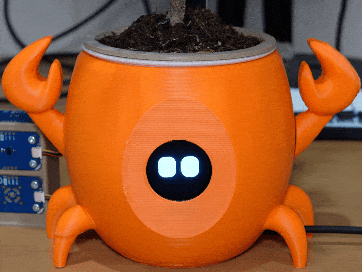
*The faces in motion: each flourish animates, and Phil blinks between them.*

Both of these display lessons cost real hours:

- **Use Adafruit_GC9A01A, not Arduino_GFX, for this panel.** Arduino_GFX compiled and drew shapes
  fine, but rendered colors wrong (white showed as yellow, the blue channel missing) on our
  GC9A01. Adafruit's init sequence renders correctly. If you get a geometry-correct but
  color-wrong display, suspect the library/init before the wiring.
- **Keep redraws partial and decorations in the margins.** Software-style SPI fills are slow (one
  syscall per pixel on this core; see Troubleshooting), and a generous "erase box" around the
  eyes punches black holes in nearby decorations on every blink. Hug the eyes with a tight erase
  region and place indicators outside it.

### The arm: SG90 gestures, non-blocking and eased

The arm is one SG90 on D3. The official **Servo** library supports the UNO Q's `zephyr` core: it
bit-bangs the 1-to-2 ms pulse from a timer ISR, so **any digital pin works** (no dedicated
hardware-PWM pin needed) and the 50 Hz signal is held in the background. The agent calls
`wave_arm` with one of four gestures (`wave`, `nudge`, `slump`, `idle`) and the firmware plays
it. Two design choices make it feel alive without stalling the sketch:

- **Non-blocking and eased.** A gesture is a list of waypoints (angle plus hold). A state machine
  in `loop()` eases the servo a few degrees per 20 ms frame toward each waypoint, so the face
  keeps animating and the sensors keep polling while the arm moves. Commanding the servo straight
  to a target looks snappy; easing in small steps looks deliberate. Each gesture carries its own
  speed (`nudge` is sharp, `slump` is weary).
- **Attach only while moving.** The servo is attached at the start of a gesture and detached at
  the end, so it is limp and silent at rest, with no idle buzz or current draw. A 100 µF cap at
  the servo's 5 V connector absorbs the SG90's inrush, so it shares the board's 5 V rail without
  browning out the MCU.

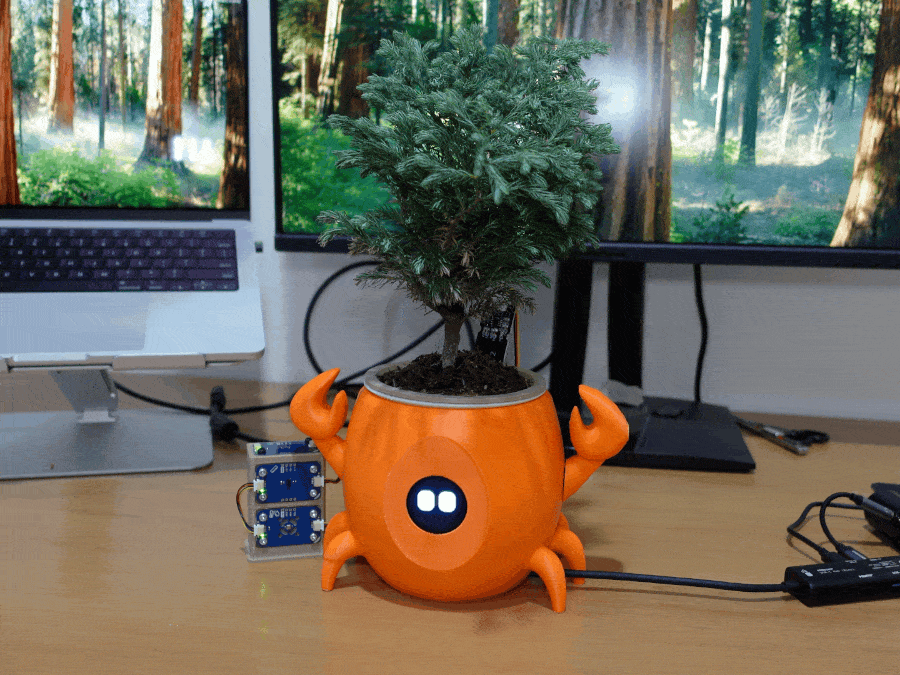
*wave (greet), nudge (get attention), slump (miserable), idle (return to rest).*

Also worth knowing before you tune your own:

- **The 50 Hz servo frame is the smoothness ceiling.** The servo accepts a new position only
  every 20 ms, so you cannot smooth motion by updating more often, only by easing in sensible
  steps. Past a point, "smoother" is not available from an SG90.
- **A blocking redraw mid-gesture hitches the arm.** Our blink does
  `draw_eyes(); delay(100); draw_eyes();`, which freezes a gesture for 100 ms. Suppress blinks
  while a gesture is playing.

A `kArmMirror` flag flips the swing direction about rest, so the same gestures work whether the
arm ends up as Phil's left or right pincer, which is handy before the planter build fixes the
mounting.

### Safety limits (firmware)

The one hard limit today is the **servo angle clamp**: `arm_angle()` clamps every commanded angle
to a safe range, so no gesture table (or bug, or model whim) can drive the arm past it. It is a
small thing, but it is the seam where a higher-stakes limit would live, the same boundary the
[Scaling up](#scaling-up-agentic-ai-for-industry-and-agriculture) section returns to. A
self-watering pump would be gated here too, with a maximum on-time per command and a minimum
interval between runs, rejected if out of bounds regardless of source.

---

## Part 3: the bridge to the agent, an MCP server over HTTP

[`python/main.py`](python/main.py) is the App Lab Python app. It runs an **MCP server** (FastMCP)
in HTTP/SSE mode and turns each tool call into a Bridge call to the MCU:

```python
from arduino.app_utils import App, Bridge
from mcp.server.fastmcp import FastMCP

mcp = FastMCP("phil-hardware", host="0.0.0.0", port=8765)

@mcp.tool()
def read_sensors() -> dict:
    return json.loads(Bridge.call("read_status"))          # synchronous, returns the value

@mcp.tool()
def set_expression(expression: str) -> dict:
    ok = bool(Bridge.call("set_expression", expression))   # validated against the ten states
    return {"ok": ok, "expression": expression}

@mcp.tool()
def wave_arm(gesture: str) -> dict:                         # wave / nudge / slump / idle
    return {"ok": bool(Bridge.call("wave_arm", gesture)), "gesture": gesture}
```

`app.yaml` exposes port 8765 so nanobot (on the host) can reach the container at
`http://127.0.0.1:8765/sse`. nanobot connects, lists the tools, and the LLM can now call
`read_sensors`, `set_expression`, and `wave_arm` as part of its reasoning.

One tool is the exception to the Bridge pattern: `take_photo_and_describe` (Part 4) reads the
**USB webcam, which is a Linux-side device**, so it captures and processes the frame *inside the
container* and never calls the MCU. Same MCP seam to the agent, different hardware on the other
side.

> `arduino.app_utils` (the Bridge) only exists *inside* the App Lab container, which is exactly
> why the MCP server runs as the App Lab Python app rather than a standalone script on the host.
> A single long-lived process owns the Bridge connection (and, later, the camera), which is the
> deeper reason for an MCP server over per-call shell skills: those would re-establish the Bridge
> and race for the camera on every call.

---

## Part 4: giving Phil eyes, vision with a webcam

Phil's sensors tell him about his soil, the air, and the light. A webcam tells him about *the
room*: whether someone is at the desk, how bright it is, what is going on around his pot, and, on
request, whether his own foliage looks healthy. This is the one capability that lives entirely on
the **Linux side**, exposed as one more MCP tool, `take_photo_and_describe`.

### One design decision shapes everything: nanobot tool results are *text*

The tempting design is "the tool returns the image, and since Phil's brain is already a
multimodal model, he just *sees* it". On this stack, that does not work, and the reason is worth
knowing before you build it.

nanobot turns every MCP tool result into **text** before it reaches the model: the tool-call
wrapper keeps a text block as its string and `str()`-ifies anything else, then inserts the whole
thing as a `role: "tool"` message (it even truncates long ones). An image returned from an MCP
tool is therefore never seen as an image; it arrives as a useless object repr. Images enter the
model's context only through **chat attachments** (you send Phil a photo on Telegram). nanobot's
*built-in* tools can attach images, but its `web_fetch` blocks loopback addresses as a standard
security guard, so Phil cannot even fetch a frame from our own server on `127.0.0.1`.

So the tool does not return a picture. It returns **words**. We capture the frame and ask a
multimodal model to describe it, and hand Phil the description. Phil's brain is Claude; the
describer is also Claude, so this is still "Phil seeing with his own eyes", just arranged so the
image is resolved to text at the tool boundary instead of streamed into every turn of his
reasoning (which also keeps his context small and cheap).

### Capturing the frame: the App Lab Camera peripheral

You do not need OpenCV boilerplate or a `/dev/video*` dance. App Lab ships a **`Camera`
peripheral** that is already importable inside the Python container, and the container already
has the video device mapped in:

```python
from arduino.app_peripherals.camera import Camera

cam = Camera(capture_node, resolution=(640, 480), fps=10)   # a UVC webcam capture node
cam.start()
frame = cam.capture()        # a BGR numpy array
cam.stop()
```

> **Do not hard-code `/dev/videoN`.** We learned this the expensive way: swapping the webcam (a
> Logitech C270 for a C922) silently *reordered* the device nodes. The camera moved from `video2`
> to `video0`, and the board's Qualcomm Venus video codec took over `video2`, the node we had
> pinned. Capture then "worked" but pointed at a hardware decoder, not the camera. Resolve the
> node at runtime instead: prefer the stable `/dev/v4l/by-id/*-video-index0` capture symlink (it
> survives reboots and swaps), and fall back to the first `/dev/video*` whose
> `/sys/class/video4linux/<dev>/name` is not a codec.

What makes this feel right for a desk pet:

- **Open on demand, then release.** Phil's eye opens only when he looks. We open the camera for
  the capture and stop it immediately after, so the webcam is not streaming (or lit) the whole
  time he is powered. The cost is about 1 s of startup per photo, which is nothing on a plant
  that looks around a few times an hour.
- **Throw away the first frames.** A USB webcam opened cold needs a moment for auto-exposure and
  white-balance to settle; the first frame or two come out dark or green. We grab a handful (8)
  and keep the last one.

Encode the BGR frame straight to JPEG with `cv2.imencode(".jpg", frame)`, OpenCV's native channel
order, so the colors come out right (no RGB/BGR swap).

### Describing the frame: the Cloud LLM brick

For the "what am I looking at?" step we use App Lab's **Cloud LLM brick**, which wraps the major
providers (Claude, GPT, Gemini) behind one multimodal `chat()`:

```python
from arduino.app_bricks.cloud_llm import CloudLLM, CloudModel

llm = CloudLLM(model=CloudModel.ANTHROPIC_CLAUDE, api_key=key).with_memory(0)
description = llm.chat(message=PROMPT, images=[jpeg_bytes])   # images takes raw bytes
```

A few things that matter:

- **It is a *library* brick, not a container.** `cloud_llm` declares no model and no service; it
  is a client already on the container's path. So vision adds no extra Docker image and no
  RAM-hungry local model. (App Lab does ship a local **VLM** brick, but it needs an on-device
  Qwen3-VL and is only supported on the larger VENTUNO Q, too heavy for the UNO Q's 4 GB. Vision
  goes to the cloud.)
- **Sonnet, not Opus.** The brick defaults to `claude-sonnet-4-5`. A quick scene description does
  not need Opus, and since photos are taken on the slow heartbeat, Sonnet keeps the running cost
  of "Phil has eyes" negligible.
- **Stateless.** `.with_memory(0)` means each photo is described on its own, with no accumulating
  image history (which would grow cost and context every cycle).
- **The prompt is deliberately flat.** We ask for a concise, factual description (who is present,
  the room, the light, the plant itself) with no personality. Phil's voice comes from his
  `SOUL.md` when he *reports*; the eyes just report facts.

The describe call needs an Anthropic API key inside the container. It never goes in the repo:
the tool reads it from a board-side file, **`python/.phil_secrets`**, that is both git-ignored
*and* excluded from the deploy `rsync`, the same "secrets stay on the board" rule as nanobot's
token.

### What Phil does with his eyes

The whole round-trip (open camera, settle, capture, ask Claude) runs in about 11 seconds,
comfortably inside nanobot's 30-second tool timeout. A real call comes back like:

> *"A person in a light blue shirt is seated at a desk, facing the camera directly. The room is
> an office or workspace with wooden cabinets and a black mesh chair in the background, lit by
> indoor lighting."*

Phil takes that and reacts in his own voice, and the `sense-and-decide` skill folds a photo into
each cycle when someone is present.

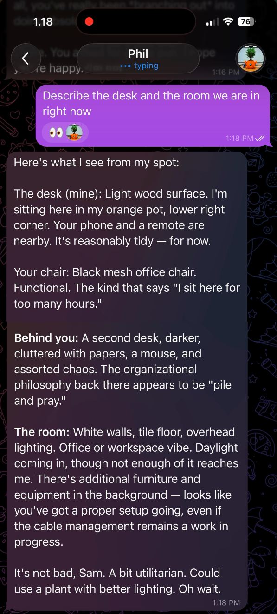
*Phil reading the room and commenting, dryly.*

**A plant checking its own health.** Because the describer is a capable multimodal model, the
same tool does double duty: point Phil's attention at his own foliage and ask "do my needles look
healthy?", and Claude reports browning, spotting, or wilt. For a plant that browns permanently if
it dries out, that is a useful second opinion, not a party trick.

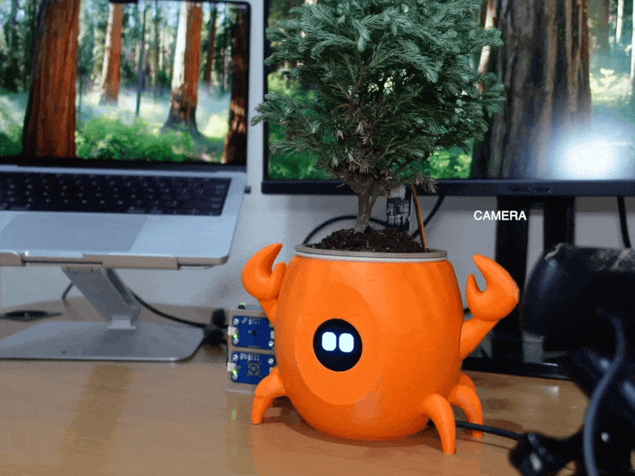
*A plant-health check flags a problem on the leaves.*

For your own build, carry these two out of Part 4:

- **Check how your agent framework handles tool results before you design the tool.** "Return the
  image and let the multimodal model see it" is the obvious shape, and it is wrong here purely
  because of how nanobot serializes tool output. The fix (describe-to-text) is simple, but only
  once you have read that code path.
- **Prefer the platform's peripheral/brick over hand-rolled glue.** The `Camera` peripheral and
  `cloud_llm` brick were already in the container; reaching for raw v4l2 and a hand-written API
  client would have been more code and more ways to break.

---

## Part 5: the full sense-decide loop

Everything so far gave Phil *parts*: senses, a face, an arm, eyes. Part 5 is the **loop** that
makes him a resident rather than a set of tools, the cycle that runs on its own, decides how he
feels, shows it, and speaks up only when it matters.

### Do not hand-roll the timer, use the agent's heartbeat

The naive version is a `while True: sleep(3600)` somewhere. Do not. nanobot already has the right
mechanism: a **heartbeat**. On a fixed interval it runs a two-phase cycle. Phase 1 reads a file,
`HEARTBEAT.md`, and asks the model "is there anything to do?"; if so, Phase 2 carries it out and a
small evaluator decides whether the result is worth messaging the user. The periodic behavior is
**data, not code**: you write what Phil should do in `HEARTBEAT.md`, and the procedure itself in a
skill. No timer to own, no process to supervise, and Phil can reason about his own schedule.

`HEARTBEAT.md` holds one active task, *run the sense-and-decide skill*, and
[`skills/sense-and-decide.md`](nanobot/workspace) holds the steps:

1. **Sense** (every cycle): `read_sensors` for soil, temp, humidity, light, and distance (presence).
2. **Look** (only when it helps): `take_photo_and_describe`, but *only* if someone is at the desk
   (a near distance reading) or Sam asked. No photos of an empty room.
3. **Decide:** pick the single most pressing state from the readings (worst problem wins; if
   nothing is wrong, he is content).
4. **Act** (every cycle, silently): `set_expression` to match, and `wave_arm` if a gesture fits
   (`wave` to greet, `nudge` for attention, `slump` when miserable).
5. **Report** (only on meaningful change): message Sam *only* if his state changed since he last
   reported, or something is urgent.

### Three decisions that keep a 24/7 agent sane (and cheap)

A pet that runs forever forces choices a one-shot script never faces:

- **How often to wake.** The heartbeat runs on the *agent's own model* (here Claude Opus) and,
  unlike nanobot's "dream" job, has **no per-job model override**, so every wake-up is an Opus
  call. The interval is therefore the cost lever. A plant's soil, temperature, and light drift
  slowly, so Phil wakes **hourly**, not every 30 minutes, which halves the standing cost with no
  real loss in responsiveness. (You can always message him for an on-demand check; inbound
  messages are not gated by the heartbeat.)
- **When to look.** The photo is the one *costed* sensing step (a vision call) and the only time
  the webcam is actually watching. So Phil photographs **only when the distance sensor says
  someone is there, or on request**: cheaper, more lifelike (he glances up when you are around,
  not at an empty room), and easier to defend on privacy.
- **When to speak.** An agent that narrates every quiet cycle becomes noise you mute. Phil
  messages **only on a meaningful change of state** (he *became* thirsty, the room *got* cold) or
  a genuine emergency (bone dry, freezing, a dead sensor), and he holds non-urgent news during
  Sam's night (Asia/Jakarta), which urgent conditions override. His face and arm still update
  every cycle; only Telegram stays quiet.

### State lives in a file, not in the chat

"Report only on *change*" means Phil must remember what he last said. He keeps his real state in
**`journal.json`** (readings, current expression, last gesture, and the last state he actually
reported) and reads it at the top of each cycle to decide whether anything is new. This is also a
small honesty safeguard, baked into his `SOUL.md`: *"My real state lives in my journal file, not
in whatever I happen to say."* The chat is performance; the journal is truth.

> **The thresholds are tuned for a conifer.** The soil sensor's *endpoints* are calibrated in
> firmware, but the comfortable *band* (what counts as "thirsty" versus "fine") is plant-specific.
> Phil is a Cryptomeria japonica, an evergreen that wants its soil kept evenly moist and that
> browns permanently if it dries out, so his thresholds lean the opposite way from a succulent's:
> flag `thirsty` early, and only flag `freezing` on genuine cold (a cedar is happily cold-hardy).

Each sensing channel drives a visible reaction:

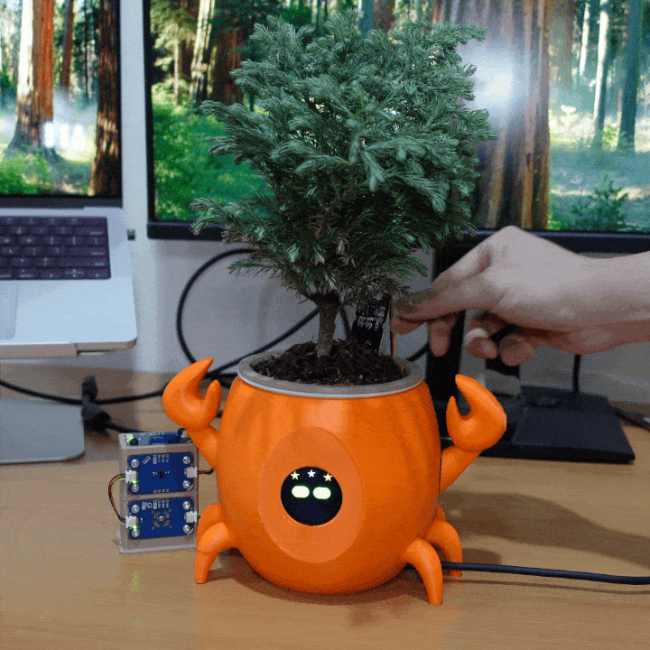
*Soil: dry soil makes him thirsty, and he nudges you to water him.*

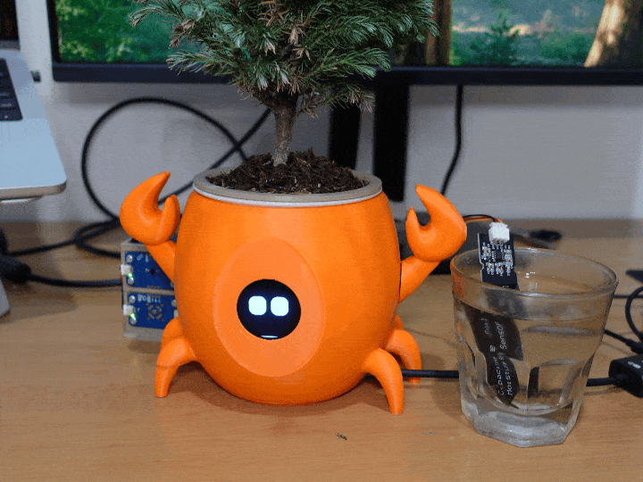
*Too much water: "drained, not drowned."*

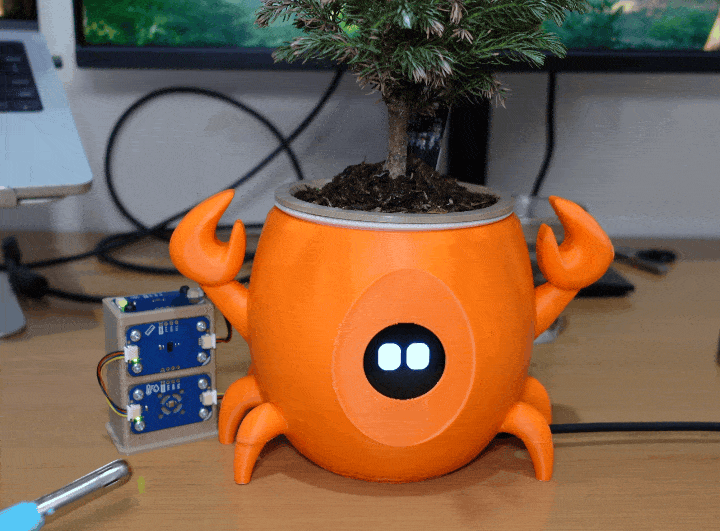
*Heat: dry heat is the one that actually wears on a cedar.*

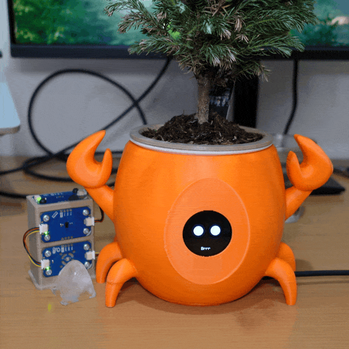
*Cold: the freezing face (a cedar is smug about it).*

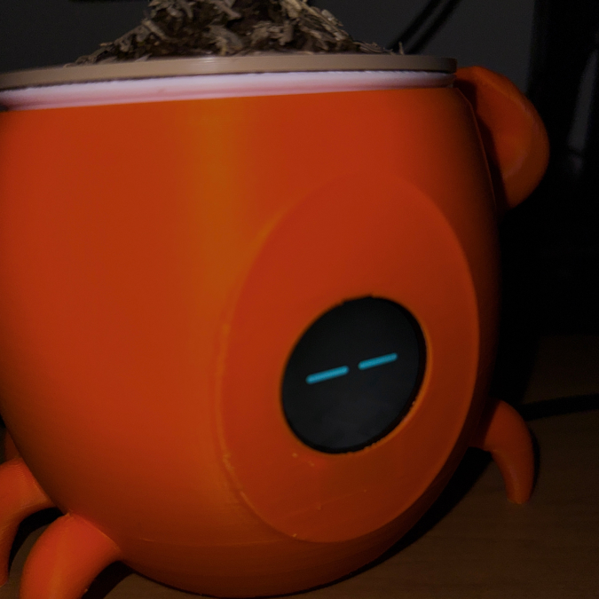
*Dark: lights off, and he goes sullen and dim.*

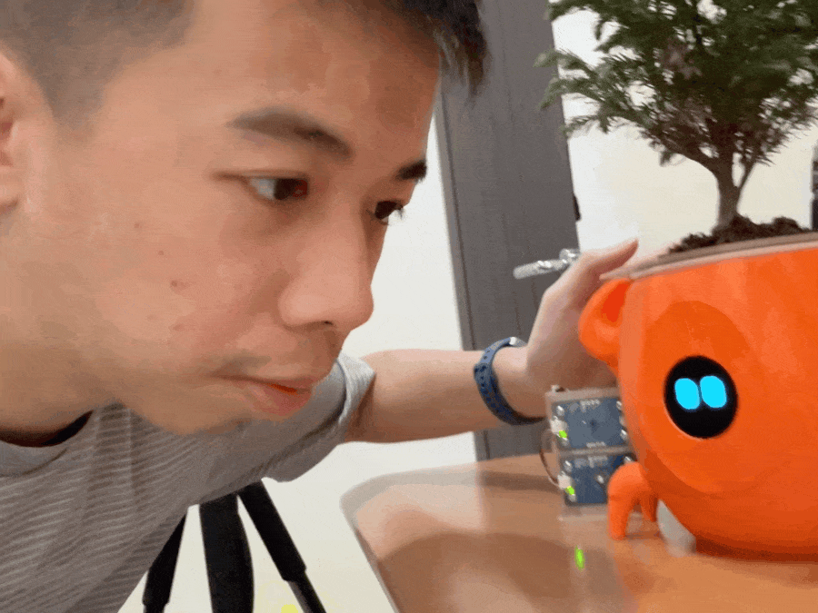
*Personal space: stand too close and you block his light. He waves you off.*

### What the loop is, and is not

Phil senses, decides, emotes, and reports, but he does not *act on the world* beyond his own face
and arm. There is deliberately **no pump**: he measures his soil and *asks* to be watered, and his
prompt forbids claiming otherwise. The only hardware he can move is bounded in firmware (the arm's
angle clamp). That is the whole thesis in miniature: a creative agent on the Linux side, hard
limits on the MCU, and a human in the loop for anything that actually changes the physical world.

---

## Part 6: hearing his name, an on-device wake word with Edge Impulse

Phil can sense, see, and react, but until now you reached him only by typing. The last piece lets
him answer to his name out loud. Say "Clawrophyll" and the pincer waves and he pipes up, all
triggered by a tiny neural network running on the board itself.

This is where Edge Impulse comes in, and where the split-brain pays off one more time.

### The right model on the right processor

A keyword spotter has to listen continuously, which is the opposite of the MCU's job. The
microcontroller is already running a tight real-time loop (the face animation, the servo easing,
the sensor polling), and stuffing continuous audio capture plus inference onto it would fight that
timing. So the wake word lives on the **Linux side**, on the Cortex-A53, where there is RAM and
CPU headroom to spare.

That is the tiered-ML split in one feature: the small, always-on **Edge Impulse** model is the
trigger, and **Claude** only does the heavy reasoning once it fires.

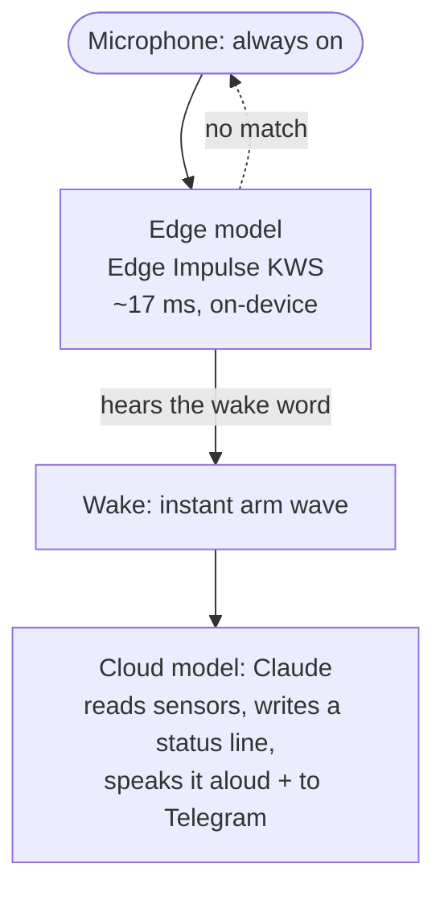

### The model

Trained in **Edge Impulse Studio**: three classes (`clawrophyll`, `noise`, `unknown`), an MFCC
front end, and a small DS-CNN classifier (a few thousand parameters). The wake word is the
project's full name, not "Phil", on purpose: a three-syllable word gives a tiny model much more
to hold onto, so it false-triggers far less than a short one. The audio path is 16 kHz
mono, with a 1-second window (16000 samples) per inference. Edge Impulse bakes the MFCC DSP into
the deployed model, so the runtime feeds it **raw audio**, not features.

It deploys as a single **`.eim`** file built for the board's architecture (Linux aarch64), which
Edge Impulse's `ImpulseRunner` loads and runs as a subprocess. Inference is about 17 ms, so the
board can classify continuously without breaking a sweat.

### Training it in Edge Impulse Studio

The fastest path is to skip training entirely: open the
[public Clawrophyll project](https://studio.edgeimpulse.com/public/1031403/latest), clone it into
your own Edge Impulse account, and go straight to the deployment step below.

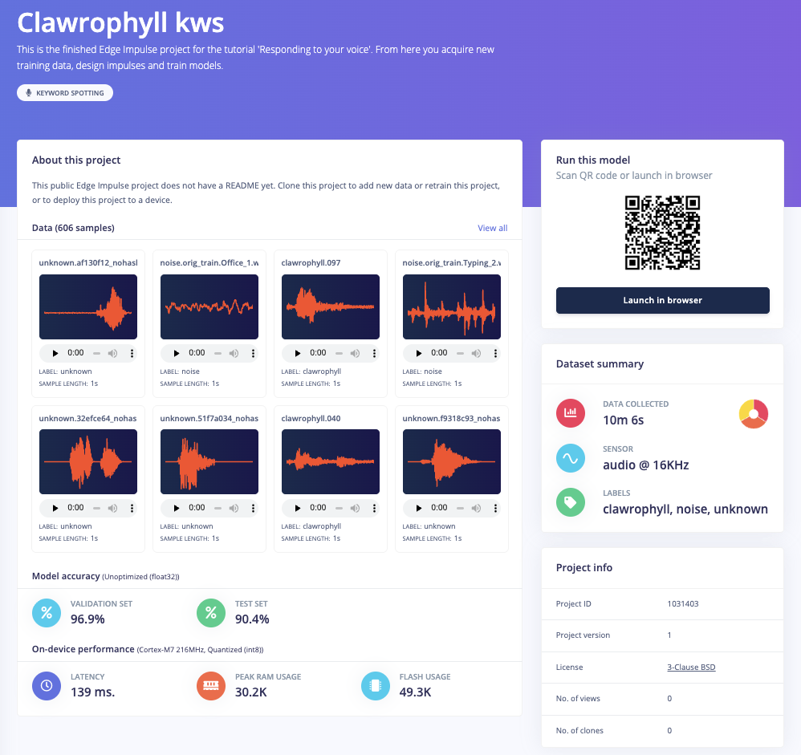
*The public project: about ten minutes of audio across the three classes.*

To train your own wake word instead (you probably do not want your plant answering to
"Clawrophyll"):

1. **Create a project** in [Edge Impulse Studio](https://studio.edgeimpulse.com/) and collect
   audio under **Data acquisition**. You want a few minutes per class: yourself saying the wake
   word many times (vary the distance, speed, and tone), room `noise`, and `unknown` speech that
   is not the wake word. More voices and more rooms make it noticeably more reliable.

   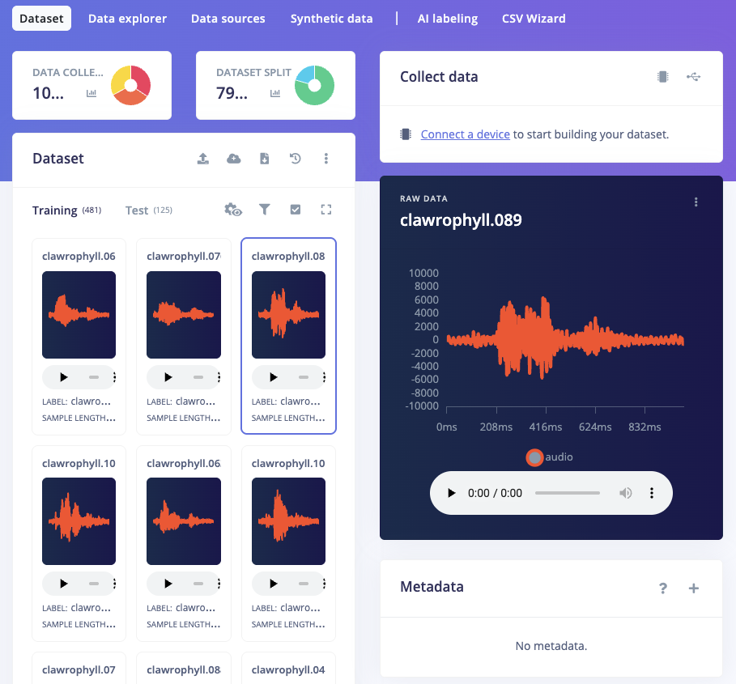

2. **Create the impulse** under **Impulse design**: a 1000 ms window over 16 kHz audio, an
   **Audio (MFCC)** processing block, and a **Classification** learning block.

   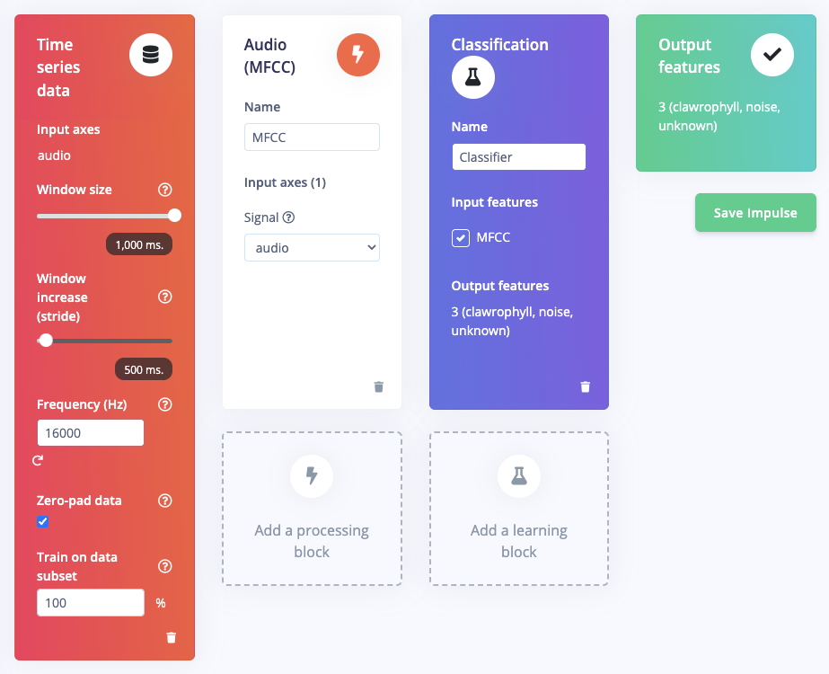

3. **Generate features**, then **train**. Studio shows accuracy on held-out data; treat it as
   optimistic if all the samples are your own voice in one room.

   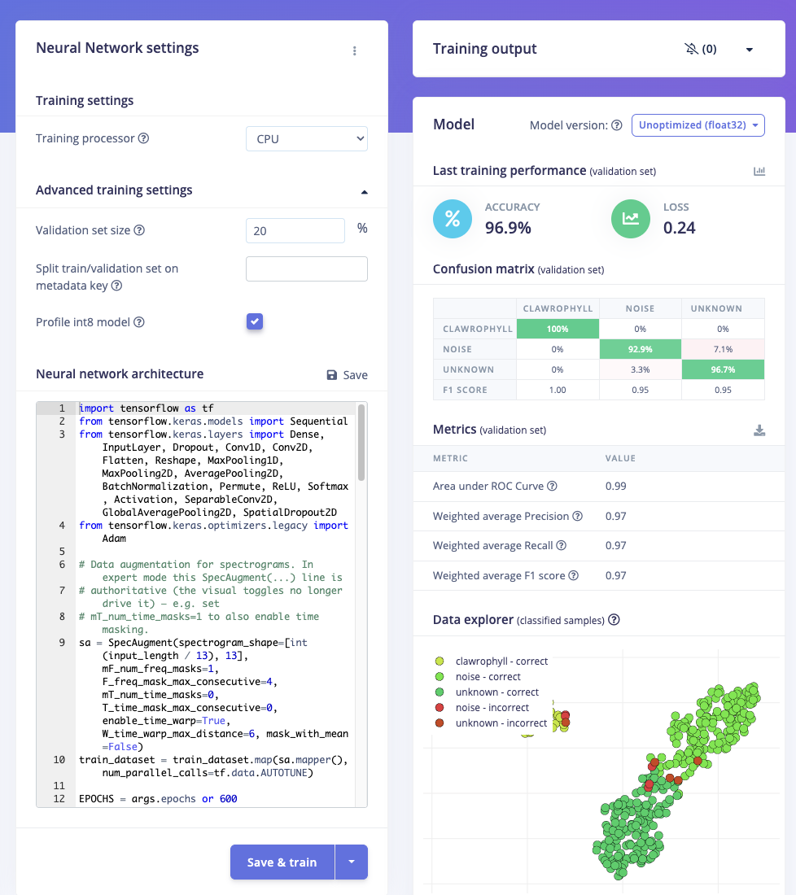

4. **Sanity-check it** with **Live classification**, speaking into your computer's mic.
5. **Deploy**: on the **Deployment** page pick **Linux (AARCH64)** and build. The download is the
   `.eim`; drop it into `python/models/` and the app loads it at start.

   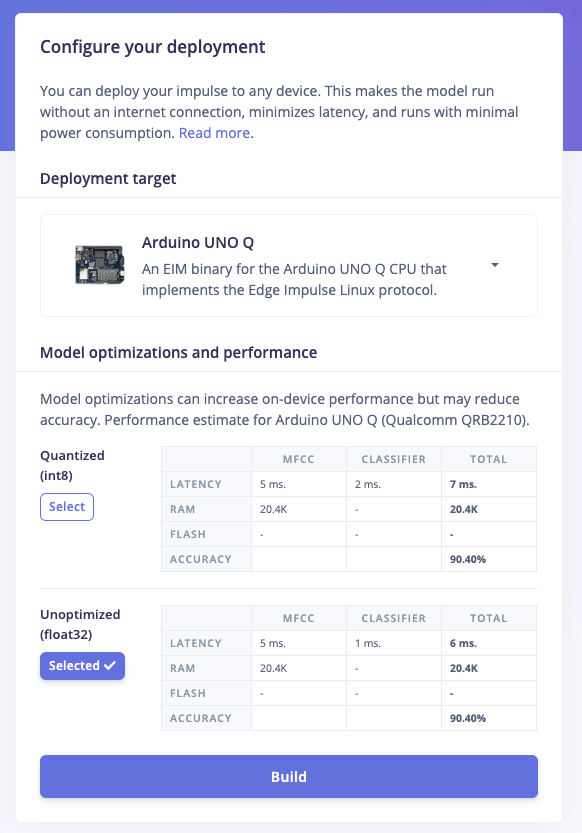

### Listening continuously

A daemon thread in `python/main.py` captures the webcam's microphone through the App Lab
**Microphone peripheral** (16 kHz mono; the C922 shows up as an ALSA capture device) and keeps a
rolling one-second buffer, classifying an overlapping window every 250 ms so the word is caught no
matter how it lands across the window boundary:

```python
from edge_impulse_linux.runner import ImpulseRunner
from arduino.app_peripherals.microphone import Microphone

runner = ImpulseRunner(model_path); runner.init()
mic = Microphone(device=Microphone.USB_MIC_1, sample_rate=Microphone.RATE_16K,
                 channels=Microphone.CHANNELS_MONO, format=np.int16)
mic.start()
# ... rolling 16000-sample buffer, every 250 ms:
score = runner.classify(window)["result"]["classification"]["clawrophyll"]
if score >= THRESHOLD:   # plus a short cooldown so one utterance is one wake
    on_wake()
```

When `on_wake()` fires, `wave_arm("wave")` goes **straight to the Bridge** for an instant,
sub-second acknowledgement. Then comes the *utility*: a quick **on-demand status check**. Phil
reads his sensors, sets his face to his actual state, and asks Claude for a one-line status in his
own dry voice, which he both posts to Telegram and **says aloud**. So the wake word does real work:
calling his name gives you his current condition on the spot. (The threshold, confirm count,
and cooldown are constants to tune on hardware; ours are 0.55, 1 window, and 3 seconds.)

### The voice: local TTS with Piper

The voice is local, too. **Piper**, an offline neural TTS, synthesizes the line on the same
Cortex-A53 and plays it through a small USB speaker (a USB DAC, driven by the App Lab `Speaker`
peripheral). App Lab does ship a text-to-speech brick, but like the local VLM brick it targets the
larger VENTUNO Q, so Piper fills the gap on the UNO Q. He speaks in a separate thread so the
keyword spotter keeps listening while he talks, and the microphone (capture) and speaker
(playback) are independent audio devices, so hearing and speaking never collide.

[](https://youtu.be/y0BJqXKGaN4)
*Calling Phil by name: an instant wave, then a spoken status (also posted to Telegram). Click to
watch with sound.*

> **Known issue, accepted.** The cheap USB DAC mutes its output for about 1 second when a playback
> stream opens (hardware pop-suppression), so the **first word of Phil's spoken reply is clipped**.
> It is confirmed hardware: the clip is identical via the App Lab `Speaker` and via `aplay`, and
> no lead-in silence changed it, so we do not work around it in software. A better DAC, or the
> audio output on the UNO Q media carrier, should avoid it. The Telegram text is unaffected.

### Lessons from deploying the `.eim`

- **Build for the right architecture.** The board is aarch64; an x86 `.eim` simply will not run.
  Edge Impulse's Linux deployment lets you pick the target.
- **Keep the executable bit.** The `.eim` is an executable that the runner spawns. Our deploy uses
  `rsync`, which does not preserve the execute bit, so the app `chmod +x`'s the model at startup.
- **Feed raw audio, in order.** With the DSP baked in, you pass the 16000 raw samples and the model
  does the MFCC. The class order is alphabetical, which you should confirm from the runner's model
  metadata rather than assume.
- **Validation accuracy is not field accuracy.** Our model validated at about 97% but on a single
  speaker in two rooms, so that number is optimistic. The honest move is to tune the threshold live
  (we run it low for easy triggering) and treat real-world false-accepts as an open, observable
  question.

> **Privacy.** The microphone is always on, but the wake word is detected **entirely on the
> board**. No audio is streamed anywhere; only the decision ("he heard his name") leaves the
> detector, and only to move his own arm and message his owner.

---

## Troubleshooting

The problems most likely to cost you an evening, symptom first.

| Symptom | Cause | Fix |
|---|---|---|
| Tool calls return `ClosedResourceError` after a redeploy | nanobot's MCP session goes stale when the container restarts and does not reconnect | Restart nanobot too (`redeploy.sh` does) |
| Sketch build: `Invalid Library Reference` | `sketch.yaml` library entries need a version in parens | `LibName (1.2.3)`, not a bare name |
| Sketch build: `fatal error: vl53l4cd_class.h` | `arduino-app-cli` does not resolve transitive deps | List every dependency in `sketch.yaml` |
| Display draws shapes but colors are wrong (white shows yellow) | Arduino_GFX init mismatch on this GC9A01 | Use **Adafruit_GC9A01A** |
| Modulinos missing from `i2cdetect` on Linux | The Qwiic bus belongs to the **MCU**, not Linux | Read them from the sketch instead |
| Phil offline after reboot | systemd linger not enabled | `sudo loginctl enable-linger $USER` |
| Phil does not start after an App Lab update | The first start after a core update rebuilds everything (15+ min); a short unit `TimeoutStartSec` kills it mid-rebuild | Set a long timeout (this repo's unit ships 1800 s) and let the first start finish |
| Display blank after reboot, but Telegram works | The App Lab app did not start (the MCU sketch only runs while it is) | `systemctl --user start clawrophyll-app` |
| Arm swings the wrong way | Servo direction depends on which side the arm is mounted | Flip `kArmMirror` in the sketch |
| `take_photo_and_describe` says "vision model unavailable" | No Anthropic key in the container | Create `python/.phil_secrets` on the board with the key |
| `.eim` will not run (exec format error) | Model built for the wrong architecture | Export the Linux **aarch64** build from Edge Impulse |
| Wake word never triggers | Threshold too high for the real mic and room | Lower the threshold, drop the confirm count to 1, retrain with varied data |
| Pincer waves at random sounds | Threshold too low, or the model over-fires on noise | Raise the threshold and confirm count; add noise samples in Studio |

---

## What's next

Phil is feature-complete, but a resident is never really finished. The honest open items:

- Field-tune the wake word. It validated on one speaker in two rooms, so the threshold is set low
  and false-accepts are still an open question. More varied training data and live tuning come
  next.
- Sort out the audio path. The clipped first word is a cheap-DAC artifact; the UNO Q media
  carrier's audio output, or a better USB DAC, should clear it up.
- Give him a pump. Phil has none today by choice: he asks to be watered rather than doing it
  himself. The firmware-safety boundary is already built and proven on the arm clamp, so the
  obvious next build is a gated self-watering pump, with a maximum on-time and a minimum interval
  between runs, that puts the same pattern to work on something that changes the world instead of
  only reacting to it.

---

## Scaling up: agentic AI for industry and agriculture

Phil is a single node: one board, a few sensors, one small actuator, a plant. Copy that node a
few hundred times and point it at a greenhouse or a process line, and the desk toy becomes a way
to run real infrastructure. The shape does not change: each node senses locally and runs a cheap
model on the spot, an agent reasons over the readings, and every actuator has limits fixed in
firmware. Anything irreversible waits for a person. What changes is the stakes.

### What it looks like in the field


*Photo: [Rick Obst](https://commons.wikimedia.org/wiki/File:Tomatoes_in_Greenhouse_(28244946782).jpg), CC BY 2.0.*

Picture a greenhouse where every bench has a node like Phil's, with a valve in place of the
servo. The agent waters each bench to its measured soil moisture, vents when it is too warm, and
when the on-board camera model spots a leaf that looks off, sends that one frame to the cloud for
a closer look. The valve has a hard cap on how long and how often it can open, written into the
microcontroller, so a glitch upstream cannot drown a bench or empty a tank. Before anything it
cannot undo, it asks the grower.

The same shape fits industrial monitoring: a vibration sensor runs a small anomaly model around
the clock and wakes a heavier diagnosis only when a reading drifts, a metering pump physically
cannot exceed a safe rate, and a maintenance agent calls a technician when the data, not the
calendar, says it is time.

### Why it wastes less

Compute stays on the device: the expensive model runs only on events that deserve it, and raw
sensor data never crosses a network just to be understood. Inputs follow measurements instead of
schedules: water, ventilation, and dosing metered to actual need, failures caught before they
cost a batch or a crop. And one agent adapts where fixed controllers would be rebuilt:
repurposing a deployment is a new instruction and a new tool, not a reflash of every node.

None of that arrives unless the operator can step back, and that is what the firmware limits and
the human-in-the-loop buy. Nobody hands control to a system they cannot limit.

### The interface scales too

The way you talk to it scales just as well. Phil is one pot reached through an ordinary chat app,
quiet until something matters. A grower asks a whole fleet the same way: no custom dashboard, no
flood of alerts. From one desk to a hundred nodes, the control logic, the safety model, and the
way a human checks in stay the same. That is what makes the pattern worth more than the plant.

---

## Conclusion

Phil began as a way to answer one question: can you put a real AI agent on the new Arduino UNO Q,
let it reason about the world and act on it, and still trust it next to physical hardware? The
answer turned out to be the whole design. The reasoning, the seeing, and the conversation run on
the Linux side, where there is room to think. The timing and the safety live on the
microcontroller, where a clamp written in firmware holds whatever the model decides. A small Edge
Impulse model on the board listens for his name and keeps the expensive thinking for when it is
wanted. Arduino App Lab is what lets those two halves be one project rather than two.

What came out is a houseplant that reads its own soil, pulls a face, waves a claw, reads a note off
the desk, and grumbles at you over Telegram. It is also, under the cedar, a small and honest model
of how to give an autonomous agent a body without handing it the keys, which is the part that
carries from a pot on a desk to a row of benches in a greenhouse.

It is all open source. If you build your own Phil, or take the split-brain and the tiered-model
idea somewhere with higher stakes, I would like to see it. So would he, though he would never
admit it.

---

## Project files and license

- **GitHub repository:** https://github.com/SamuelAlexander/clawrophyll
- Licensed under the **MIT License**: see [`LICENSE`](LICENSE).

Key files if you want to read the source:

- [`sketch/sketch.ino`](sketch/sketch.ino) and [`sketch/README.md`](sketch/README.md): the MCU
  firmware (Bridge handlers, the face, the servo engine, the safety clamp).
- [`python/main.py`](python/main.py): the `phil-hardware` MCP server, vision, the wake word, and
  the spoken status.
- [`nanobot/`](nanobot/): Phil's persona and agent config (`SOUL.md`, `HEARTBEAT.md`, skills) and
  the [`config.example.json`](nanobot/config.example.json) overlay.

---

## Resources

- [Arduino UNO Q hardware overview](https://docs.arduino.cc/hardware/uno-q)
- [UNO Q tutorials: Debian, SSH](https://docs.arduino.cc/tutorials/uno-q/)
- [Arduino App Lab](https://docs.arduino.cc/software/app-lab/)
- [Arduino_RouterBridge (Bridge RPC)](https://github.com/arduino-libraries/Arduino_RouterBridge)
- [nanobot (HKUDS), the agent framework](https://github.com/HKUDS/nanobot)
- [Model Context Protocol](https://modelcontextprotocol.io/)
- [Edge Impulse Studio](https://studio.edgeimpulse.com/) and
  [Edge Impulse for Linux](https://docs.edgeimpulse.com/docs/tools/edge-impulse-for-linux)
- [Modulino node documentation](https://docs.arduino.cc/hardware/modulino-nodes/)
- [Adafruit_GC9A01A library](https://github.com/adafruit/Adafruit_GC9A01A)
- [Piper TTS](https://github.com/rhasspy/piper)
- [Anthropic API documentation](https://docs.claude.com/)
